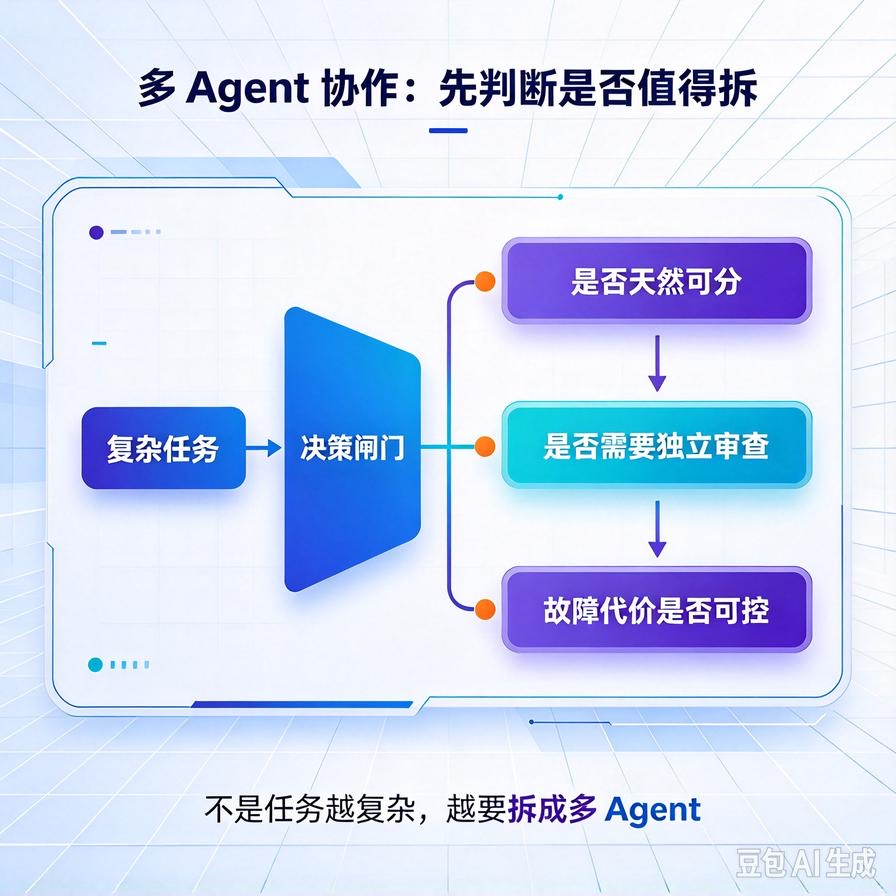
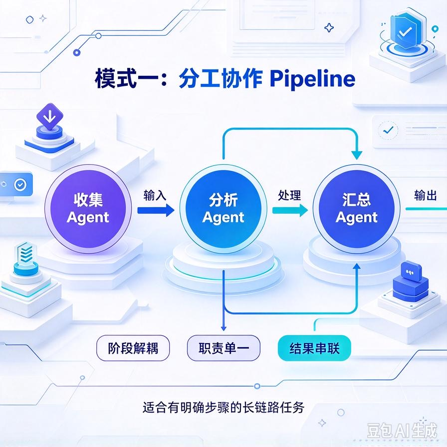
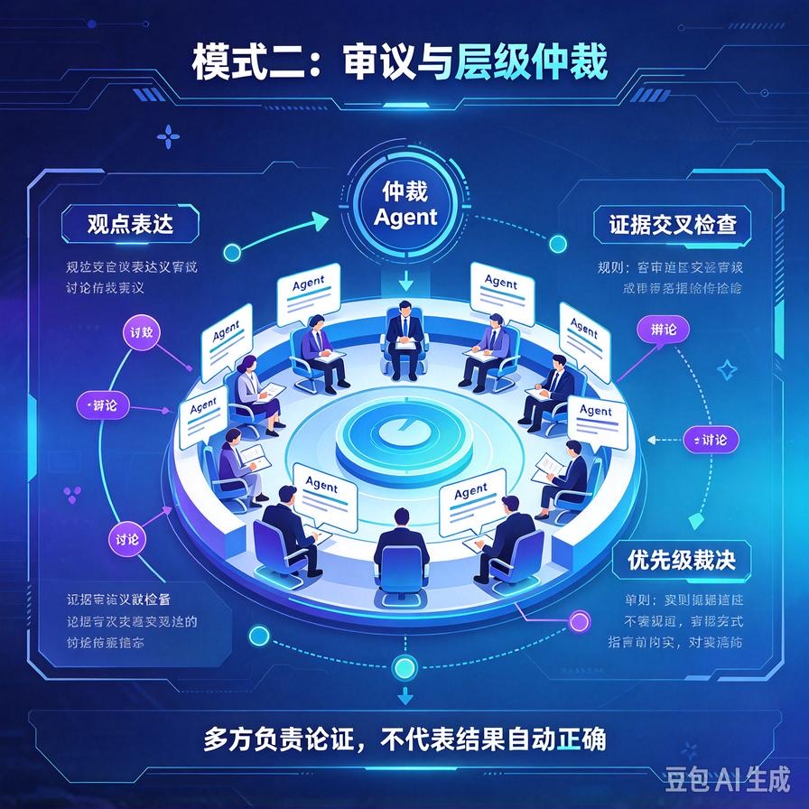
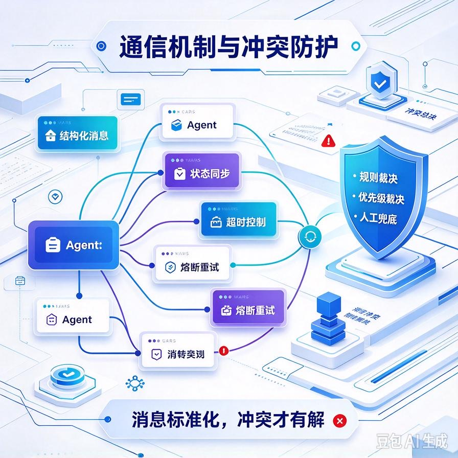

# 第59篇：多Agent协作架构 | 3种主流模式：分工、审议、层级仲裁
第58篇我们解决了单个Agent怎么用好一堆工具。但企业级的复杂任务，往往不是单个Agent能扛下来的。

举三个真实场景：一是"市场调研报告"，要同时搜集竞品、分析财务、整理渠道，一个Agent串行做完又慢又容易跑偏；二是"简历初筛"，希望多个Agent各从不同角度审，再汇总一个判断；三是"跨部门流程"，销售部Agent要发起、财务部Agent要审批、法务部Agent要会签——这根本不是"一个Agent"能装下的。

这一篇专讲三件事：**什么时候真的需要多个Agent、三种主流协作模式分别怎么搭、Agent之间怎么通信、角色冲突怎么仲裁**。文末附面试高频问答。

# 一、先泼冷水：多Agent不是越多越好

很多团队一听"多Agent"就兴奋，恨不得把每个步骤都拆成一个Agent。这是最大的误区。**多Agent的三大代价**：

- **成本成倍上涨**：每个Agent一轮就是一次完整的模型调用，N个Agent协作就是N倍Token消耗。
- **不可控性叠加**：单个Agent已经难控，多个Agent互相传递信息，错误会被放大、传播。
- **调试地狱**：出问题不知道是哪个Agent的锅，只能翻协作日志逐层排查。

判断要不要用多Agent，就一句话：**任务能否拆成几个相对独立、各司其职的模块？模块之间能否通过明确的接口交换结果？**如果答案是否定的，硬拆多Agent只会增加故障率。先问"能否用Chain或单Agent解决"，别一上来就多Agent。



# 二、三种主流协作模式

## 1. 分工模式（Pipeline / Specialist）



每个Agent负责一个独立环节，像流水线一样串联或并联，最后汇总。适合"任务天然可分、模块边界清晰"的场景，比如内容生产流水线：选题Agent→脚本Agent→配图Agent→审核Agent。

```python
def pipeline_chain(topic):
    # 1. 选题 Agent
    outline = agent_topic(topic)          # 产出大纲
    # 2. 脚本 Agent，消费大纲
    script = agent_script(outline)        # 产出脚本
    # 3. 配图 Agent，消费脚本关键点
    images = agent_image(script[:500])    # 产出配图提示词
    # 4. 审核 Agent 把关
    review = agent_review(script)         # 返回审核意见
    return {"script": script, "images": images, "review": review}
```

分工模式的关键：**每一步的输出要结构化**，下游Agent只认上一环的接口，不读原始材料。这样任何一环出问题都能单独替换、单独重跑。

## 2. 审议模式（Debate / Critic）



多个Agent从不同视角审查同一件事，最后综合成一个判断。最适合"高风险、需要多角度把关"的场景，比如代码评审、内容安全审查、方案可行性论证。

典型结构：一个"执行Agent"产出初稿，多个"评审Agent"从不同角度挑问题（安全评审、逻辑评审、合规评审），再把意见汇总给执行Agent改进或由仲裁者定夺。审议模式的精髓是**视角的多样性**，所以评审Agent的角色设定要差异明显，否则等于没审。

## 3. 层级仲裁模式（Hierarchical / Orchestrator）

一个"主管Agent"（Orchestrator）负责拆解任务、派发子任务给"执行Agent"、收集结果并做最终决策。适合流程复杂、需要统一调度和最终拍板的场景，比如跨部门协作、项目管理系统。

层级模式的优势是**权力集中、决策清晰**，主管Agent是唯一对外输出、唯一负责的人，出问题好追责。缺点是主管Agent容易成为性能瓶颈和单点故障。

# 三、Agent之间的通信机制



无论哪种模式，Agent之间交换信息都要定好通信协议。三个工程要点：

## 1. 结构化消息，别传自由文本

Agent之间传递的永远是**结构化JSON**，含消息类型、发送方、内容、时间戳。自由文本传递会让下游Agent解析不稳定，也会让日志很难排查。

## 2. 职责字段 + 消息路由

每条消息要带"发给谁、谁回复、主题"，由消息总线按字段路由。这样加Agent、删Agent不会牵动其他环节。

## 3. 状态机管理生命周期

每个任务要有状态：待处理→执行中→已完成/失败/超时。主管Agent靠状态机判断下一步，防止某个Agent卡死整个流程。

```python
import json, time

def send_message(to_agent, msg_type, payload):
    return {
        "from": "orchestrator",
        "to": to_agent,
        "type": msg_type,
        "payload": payload,
        "ts": int(time.time())
    }

def run_with_timeout(func, args, timeout=30):
    """子任务超时兜底，防止单个Agent卡死全流程"""
    import concurrent.futures
    with concurrent.futures.ThreadPoolExecutor(max_workers=1) as ex:
        fut = ex.submit(func, *args)
        try:
            return fut.result(timeout=timeout)
        except concurrent.futures.TimeoutError:
            return {"error": "timeout", "message": "子Agent执行超时，请重试或转人工"}
```

# 四、角色冲突与仲裁

多Agent协作里，冲突不可避免：两个Agent给出矛盾结论、都认为该自己拍板、一个Agent改了另一个Agent刚写的数据。工程上三层仲裁：

- **规则层**：能写死的规则先写死，比如"财务审批结论优先级高于销售建议"，避免模型去争。
- **优先级层**：给每个Agent定一个优先级，冲突时高优先级者为准（通常主管Agent最高）。
- **人工兜底层**：规则和优先级都判不了的高风险冲突，直接转人工仲裁，Agent只负责把双方意见整理给用户。商用项目里，高风险冲突永远以人工为最终裁决。

# 五、工程踩坑清单

- **过度拆Agent**：能用单Agent/Chain解决的，别拆多Agent。先做减法。
- **角色设定不鲜明**：评审Agent之间视角要拉开（安全/逻辑/合规），否则审议等于走过场。
- **通信传自由文本**：Agent之间必须走结构化JSON + 消息路由，否则下游解析不稳定、日志难查。
- **没有超时和状态机**：一个子Agent卡死，整个协作流程就挂。每个子任务都要有超时和重试上限。
- **缺少日志追踪**：必须给每条消息加trace_id，贯穿整条协作链路，出问题才能一键定位到是哪个环节。

# 📝 面试高频问答

## Q1：什么时候需要用多Agent，什么时候不该用？

答：当任务能拆成多个相对独立、各司其职的模块，且模块间能通过明确接口交换结果时，适合多Agent（如流水线、多方评审、跨部门流程）。反之，能用单Agent或Prompt Chain解决的，别拆多Agent——多Agent成本成倍上涨、不可控性叠加、调试更困难。判断标准是"任务是否天然可分、模块边界是否清晰"。

## Q2：多Agent有哪几种主流协作模式？

答：三种。分工模式（Pipeline），各Agent负责独立环节流水线作业，适合边界清晰的生产型任务；审议模式（Debate/Critic），多Agent从不同视角审查同一事项再综合，适合高风险多角度把关；层级仲裁模式（Hierarchical），主管Agent拆解派发、集中决策，适合复杂流程和最终拍板。三者可按任务性质组合。

## Q3：多Agent之间怎么通信，避免信息混乱？

答：用结构化消息（JSON，含类型、发送方、内容、时间戳）+ 消息路由（按职责字段分发）+ 状态机管理任务生命周期（待处理/执行中/完成/失败/超时）。不要传自由文本，要为每个任务打trace_id贯穿全链路，方便追踪和排查。

## Q4：两个Agent结论冲突时怎么仲裁？

答：三层仲裁。规则层先把能写死的优先级写死（如财务审批高于销售建议）；优先级层给Agent定优先级，冲突时高者为准（主管Agent最高）；规则和优先级都判不了的高风险冲突转人工兜底。商用项目里高风险冲突永远以人工为最终裁决。

## Q5：多Agent系统如何防止单个Agent卡死整个流程？

答：给每个子任务设超时（如30秒），超时返回兜底结果而不是让流程挂起；加任务状态机，主管Agent靠状态判断下一步；设重试上限，防止无限重试；关键子任务可降级为人工处理或跳过，保证主流程不中断。

---

下一篇我们回答一个让所有做Agent的人都头疼的问题：**Agent效果到底怎么量化评估**。从自动化评测集、指标设计到人工校验，讲清楚怎么衡量Agent"到底好不好用"。

> 来源：头条号《AI Agent 零基础实战》第59篇｜版权归作者所有，仅供学习交流
