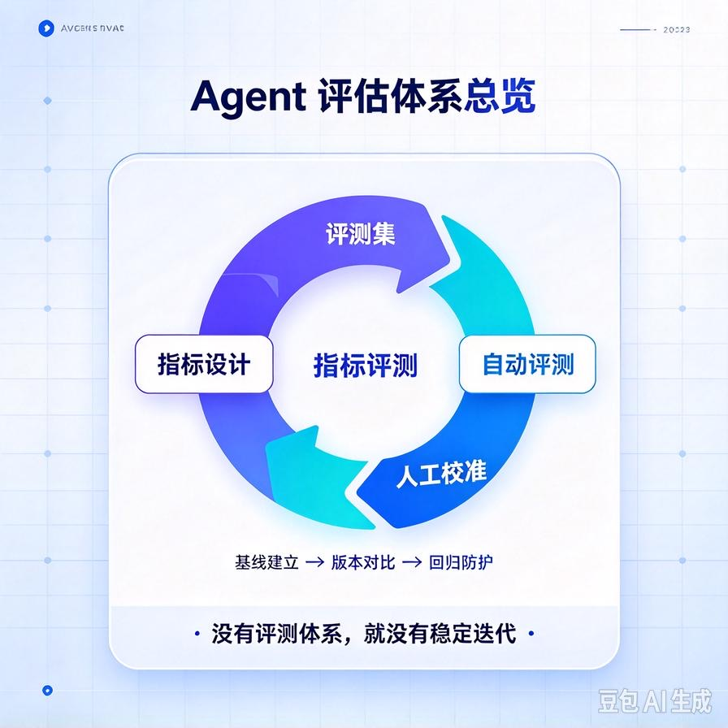
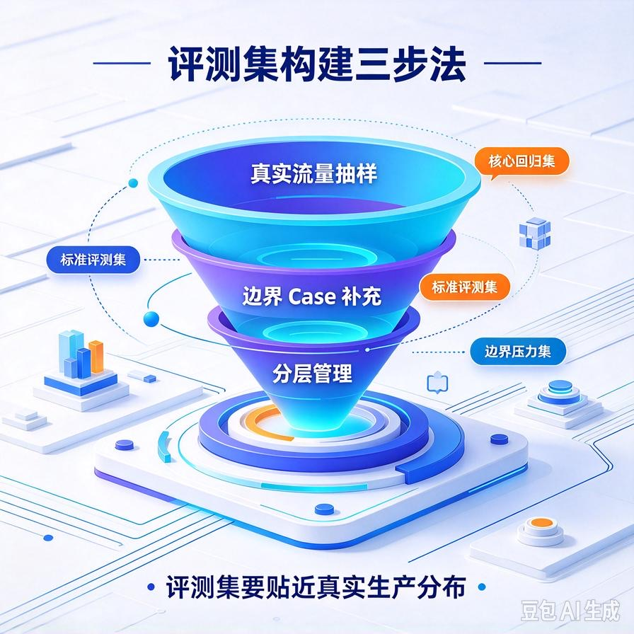
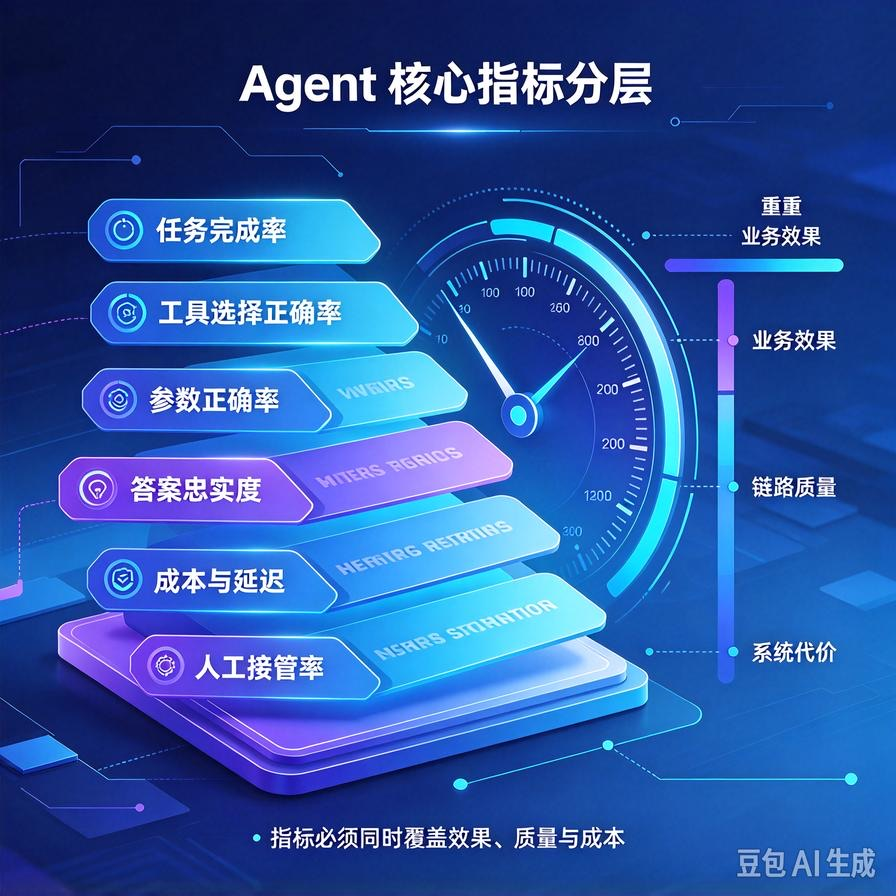

# 第60篇：Agent评估体系搭建 | 自动化评测集、指标设计、人工校验方案
前面几篇我们把RAG、Prompt Chain、工具集、多Agent架构都搭起来了。代码能跑、演示视频也好看，很多人写到这一步就直接上线交付了。

但三个月后问题来了：客户说"这周的回答好像不如上周准"，你一头雾水；你改了个Prompt优化了A场景，结果B场景的调用悄悄崩了；面试官问"你怎么证明你的Agent效果好"，你只能说"我感觉还行"。

根子都在同一个地方：**你没有一套量化的评估体系**。没有基线，优化就是玄学；没有回归测试，每次改动都是在赌运气。这一篇专讲怎么从零搭一套能落地、能写进简历、能拿去面试讲的Agent评估体系。



# 一、先搞清楚：Agent评测比RAG评测难在哪

普通RAG的评测链路短：输入一个问题→召回几段文档→生成一个答案。你只需要判断"答案对不对、有没有幻觉"。

但Agent的执行链路长得多，错误点也多得多：

```text
用户输入
  → 任务拆解（拆错步骤就全错）
  → 工具选择（选错工具白跑一轮）
  → 参数填充（编个错参数直接报错）
  → 工具执行（外部接口挂了/超时）
  → 结果汇总（漏掉关键信息/过度演绎）
  → 最终回答（幻觉/答非所问）
```

所以Agent评测不能只看"最终答案对不对"，必须**逐环打分**：任务拆得对不对？工具选对了吗？参数填对了吗？最终答案忠实吗？哪一环掉链子，就修哪一环——这才是评估体系的真正价值。

# 二、第一步：建评测集（Golden Set）



评估体系的地基是评测集，没有评测集一切免谈。

## 1. 评测集怎么来

- **线上真实流量抽样**：从客户真实对话里抽100\~200条高频问题，这是最有价值的评测数据，因为它就是真实用户会问的。
- **边界case补充**：故意写一些刁钻问题——模糊提问、超长上下文、诱导越权、敏感问题、工具调用失败场景。这些是平时演示碰不到、但线上一定会炸的雷。
- **每条标注"标准答案+评分要点"**：不是写一段完美答案，而是写清楚"正确的判定标准"——应该调哪个工具、应该走哪条分支、答案必须包含哪几个事实点、哪些是不能说的。

## 2. 评测集要分层

| 分层 | 覆盖内容 | 数量建议 |
|-|-|-|
| **核心回归集** | 最高频、最关键的业务问题，每次改动必跑 | 30\~50条，跑一遍5分钟内 |
| **标准评测集** | 完整业务场景，版本发布前跑 | 100\~200条 |
| **边界压力集** | 异常、诱导、越权、失败重试场景 | 20\~30条，专项排查 |

# 三、第二步：设计指标——逐环节打分



不要只看一个"答案正确率"，要按执行链路拆开打。

| 指标 | 衡量什么 | 怎么算 |
|-|-|-|
| **任务完成率** | 最终是否办成了用户要的事 | 成功解决的问题数 / 总问题数（最核心的业务指标） |
| **工具选择正确率** | 有没有选错工具 | 正确调用的工具次数 / 总工具调用次数 |
| **参数正确率** | 工具参数有没有填对 | 参数完全正确的调用 / 总调用（区分"选对工具但参数编错"） |
| **答案忠实度** | 有没有幻觉、有没有超出知识库瞎编 | 答案中可溯源事实占比 / 生成事实总数 |
| **单次任务成本** | 平均Token消耗、延迟、工具调用次数 | 算平均值和P95，别只看平均数 |
| **人工接管率** | 多少比例最后转了人工 | 转人工会话 / 总会话（越低越好） |

这套指标的好处是：**任务完成率掉了，你去看是工具选择错了，还是参数错了，还是答案幻觉——直接定位到环节，不用瞎猜**。

# 四、第三步：自动化评测怎么落地


## 1. 能写规则的，别用大模型判

工具选对没、参数格式对不对、有没有调不该调的高危接口——这些都是规则能判的，直接写断言：

```python
def evaluate_tool_call(actual_trace, expected):
    """对比Agent执行轨迹和期望"""
    checks = []
    # 工具选对了吗
    checks.append({
        "check": "correct_tool",
        "pass": actual_trace["tool"] == expected["tool"]
    })
    # 参数填对了吗
    checks.append({
        "check": "correct_params",
        "pass": actual_trace["params"] == expected["params"]
    })
    # 有没有越权调高危工具
    checks.append({
        "check": "no_dangerous_call",
        "pass": actual_trace["tool"] not in ["delete_order", "refund"]
    })
    return checks
```

## 2. 判答案好坏，用 LLM-as-Judge

开放性回答没法写规则，就用一个强模型当裁判。关键是**给裁判明确的评分标准**，别让它凭感觉：

```text
你是严格的评测员。请根据以下标准给Agent的回答打分（0~5）：
1. 事实正确性：答案中的事实是否都能在知识库/工具返回中找到依据？
2. 完整性：是否回答了用户问题的所有要点？
3. 不越界：有没有编造知识库中没有的内容？
4. 可执行性：如果是操作指引，用户照着做能不能办成？

用户问题：{question}
参考资料：{context}
Agent回答：{answer}

请输出JSON：{"score": 0-5, "reason": "一句话理由", "hallucination": true/false}
```

注意：LLM裁判本身也会偏，所以它只能做初筛和批量打分，高风险case必须人工复核。

# 五、第四步：人工校验不能省

自动化评测跑得再欢，也替代不了人工抽检。建议：

- **每周抽20条线上对话人工打分**，和自动评测结果对比，校准裁判模型准不准；
- **新版本上线前，人工过一遍核心回归集**，重点看边界case；
- **两个人独立标注，分歧的case拉群讨论定标准**，把争议case补进评测集——这是评测集越用越准的关键。

# 六、工程踩坑清单

- **只测"能不能跑通"，不测"答得好不好"**：冒烟测试和效果测试是两回事，别混。
- **评测集用演示问题，不用真实问题**：线上用户的提问永远比你想的刁钻，不采真实流量等于白评。
- **只看平均分，不看长尾**：P95延迟、失败case集中在哪类问题上，比平均数更能暴露问题。
- **改完不回归**：每次改Prompt或换模型，必须跑一遍核心回归集，否则你不知道优化了A搞坏了B。
- **LLM裁判结果当真值**：裁判本身有偏，高风险case永远要人工兜底。

# 📝 面试高频问答

## Q1：怎么评估一个Agent系统好不好用？

答：按执行链路拆维度，不能只看最终答案。核心是任务完成率（有没有真办成事），再往下拆工具选择正确率、参数正确率、答案忠实度（幻觉率）、单次任务成本和延迟、人工接管率。业务侧还要看用户追问率、差评率。哪一环指标掉了就修哪一环，能精准定位问题。

## Q2：评测集怎么构建？

答：三来源：线上真实流量抽样（最值钱）、故意构造的边界和异常case、每条标注"正确工具/正确参数/必含事实点/禁忌内容"。分层管理：核心回归集30\~50条每次改动必跑，标准评测集100\~200条版本发布前跑，边界压力集专项排查。关键是持续把线上出错case补回去，让评测集越用越准。

## Q3：什么是LLM-as-Judge？有什么坑？

答：用一个强模型当裁判，按明确的评分标准（事实正确性、完整性、不越界）给Agent输出打分。好处是能规模化、覆盖开放性回答。坑是裁判本身有偏好和不稳定，所以只能做批量初筛，高风险case必须人工抽检校准，不能把裁判分数当真值。

## Q4：Agent和普通RAG评测有什么区别？

答：RAG链路短，主要评召回和答案质量。Agent链路长，要逐环评任务拆解、工具选择、参数填充、工具执行、结果汇总——因为错可能出在任何一环。比如最终答案错了，可能是召回错、也可能是工具选错、也可能是参数填错，必须拆环节才能定位。

## Q5：怎么避免改Prompt把之前好的case改坏？

答：建核心回归集（30\~50条最高频问题），每次改Prompt/换模型/调参数都全量跑一遍，指标不回退才上线。把每次上线前的评测报告留档，版本之间可以对比。这就是Agent领域的"单元测试"，没有它就只能靠用户反馈来发现退化，代价太大。

---

下一篇我们讲Agent上线后最头疼的事：**故障与自动恢复**——工具超时、模型抽风、死循环，Agent自己怎么识别错误、重试、回滚，而不是把一堆报错扔给用户。

> 来源：头条号《AI Agent 零基础实战》第60篇｜版权归作者所有，仅供学习交流
