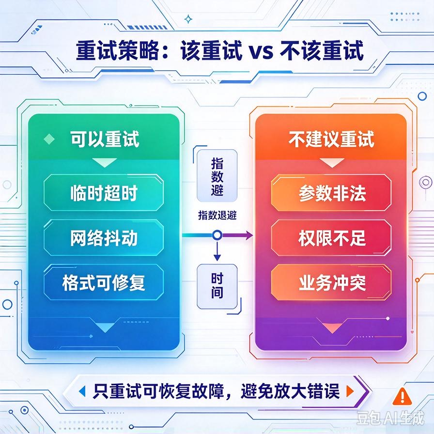
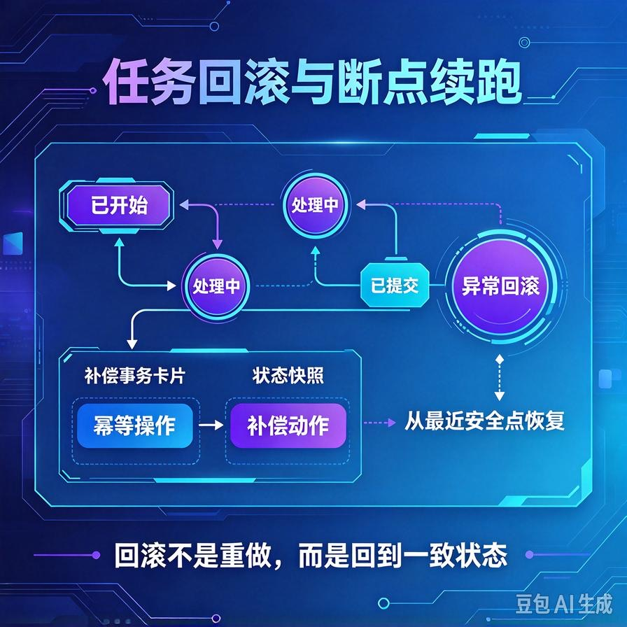

# 第61篇：Agent故障自动恢复 | 异常捕获、重试策略、任务回滚机制
第60篇我们讲了怎么评估Agent好不好用。但真正上线后，你会发现一个更现实的问题：**Agent不是永远正常的**。

线上Agent翻车的方式五花八门：大模型接口突然超时、工具调用返回500、模型陷入死循环反复调同一个工具、多Agent协作时一个子任务卡死整条流水线。用户看到的不是智能助手，而是一个转圈、报错、或者答非所问的"人工智障"。

这一篇专讲怎么让Agent在出错时**自己救自己**——异常怎么捕获、什么错误该重试、什么错误必须停、多步任务做一半崩了怎么回滚。文末附面试高频问答。

# 一、先搞清楚：Agent的故障分三层


新手处理异常，习惯用一个大try/except包住整个调用。这在Agent里完全不够用——因为错误发生在不同层，处理方式天差地别。

| 故障层 | 典型错误 | 处理思路 |
|-|-|-|
| **模型层** | 接口超时、限流429、返回格式不对、内容被安全策略拦截 | 可重试或换模型兜底 |
| **工具层** | 外部API挂了、参数错误、权限不足、返回空 | 看错误类型决定重试/换工具/转人工 |
| **编排层** | 死循环、步骤爆炸、多Agent子任务卡死、状态不一致 | 熔断、超时、回滚、转人工 |

核心原则：**不要用一个except接住所有错误，要把错误分类后分别处理**。超时和参数错误的处理方式完全不同，混在一起就是灾难。

# 二、异常捕获：把错误结构化，而不是抛出去


Agent调用工具时，**不要让异常直接冒泡给用户**。工具应该返回结构化的错误对象，让模型自己看到错误信息后决定怎么办：

```python
class ToolError(Exception):
    def __init__(self, code, message, retryable):
        self.code = code          # TIMEOUT / PARAM_ERROR / AUTH_FAIL / NOT_FOUND
        self.message = message
        self.retryable = retryable
        super().__init__(message)

def call_order_api(order_id):
    try:
        resp = requests.get(f"https://api.xxx/order/{order_id}", timeout=5)
        if resp.status_code == 429:
            raise ToolError("RATE_LIMIT", "接口限流，请稍后重试", retryable=True)
        if resp.status_code == 404:
            raise ToolError("NOT_FOUND", "订单不存在", retryable=False)
        if resp.status_code >= 500:
            raise ToolError("SERVER_ERROR", "订单服务内部错误", retryable=True)
        return resp.json()
    except requests.Timeout:
        raise ToolError("TIMEOUT", "订单查询超时", retryable=True)
```

关键设计：**每个错误都打一个retryable标签**。这个标签直接告诉上层：这种错误值不值得重试。限流、超时、服务端500——可以重试；参数错误、订单不存在、权限不足——重试一百次也没用，赶紧换路径。

# 三、重试策略：什么该重试，什么不该



## 1. 该重试的 vs 不该重试的

| 场景 | 要不要重试 | 为什么 |
|-|-|-|
| 网络超时、接口500、限流429 | ✅ 重试 | 临时性故障，再试一次大概率好 |
| 参数格式错误、404、权限不足 | ❌ 不重试 | 重试结果一样，浪费Token |
| 模型输出格式不对（不是JSON） | ✅ 重试（1次） | 让模型按格式重新输出 |
| 高危操作（退款、删除）失败 | ⚠️ 谨慎重试 | 先查状态再决定，防止重复执行 |

## 2. 指数退避 + 重试上限

重试不是无脑立即重试。限流了你还每秒打一次，只会被封得更死。正确做法是指数退避：

```python
import time

def retry_with_backoff(func, max_retries=3, base_delay=1):
    for attempt in range(max_retries):
        try:
            return func()
        except ToolError as e:
            if not e.retryable or attempt == max_retries - 1:
                raise e
            delay = base_delay * (2 ** attempt)   # 1s, 2s, 4s
            time.sleep(delay)
    raise ToolError("EXCEEDED", "重试次数用尽", retryable=False)
```

两个硬约束：**重试上限最多3次，高危操作（写操作）重试前必须先查当前状态**——防止"以为没成功其实成功了"导致重复退款。

# 四、任务回滚：多步任务做一半崩了怎么办



这是最复杂的一块。一个Agent任务可能是多步的：查订单→退款→发通知。前两步成功了，第三步挂了，钱退了但用户没收到通知——这就出大事了。

## 1. 核心思路：幂等 + 状态机

**幂等**：同一个操作执行一次和执行十次效果一样。退款接口要支持"用同一个请求号调多次只退一次"，这样重试才安全。

**状态机**：每完成一步就持久化当前状态。任务崩了重启，从状态机里读到"已经退过款了"，就不会再退一次。

```python
ORDER_FLOW = ["CREATED", "ORDER_QUERIED", "REFUNDED", "NOTIFIED", "DONE"]

def resume_task(task_id):
    state = load_state(task_id)   # 从数据库读上次走到哪了
    step = state["current_step"]
    # 根据断点继续，不从头跑
    if step == "ORDER_QUERIED":
        refund(task_id)          # 已经查过订单了，直接退款
        save_state(task_id, "REFUNDED")
    if step == "REFUNDED":
        notify(task_id)          # 已经退过了，只补通知
        save_state(task_id, "NOTIFIED")
```

## 2. 补偿事务：实在救不回来就反向操作

有些操作没法幂等（比如已经发出去的邮件收不回来），就用补偿：退款成功了但通知发不出去，就记一条"待补发通知"的补偿任务，后台定时重试，或者转人工处理。**不要假装没发生过，要留痕、要补偿**。

# 五、死循环与熔断：防止Agent自己把自己跑死


Agent最常见的线上事故不是报错，而是**死循环**：模型反复调用同一个工具、反复重新规划、步骤数爆炸，Token哗哗烧钱，用户等五分钟没结果。

三道防线：

- **最大步数限制**：一个任务最多N步（比如10步），到了就强制收尾或转人工，不让它无限跑。
- **重复调用检测**：连续3次调同一个工具、同样的参数，直接判定死循环，中断。
- **总耗时熔断**：单任务超过60秒强制超时，返回兜底话术。多Agent场景下每个子任务单独计时，一个子任务挂了不影响其他。

# 六、工程踩坑清单

- **一个except接住所有错误**：错误不分类型，重试策略就是瞎试。必须分类+retryable标签。
- **写操作不做幂等**：重试导致重复退款、重复发邮件，这是生产事故。
- **不设重试上限**：模型陷入错误循环时，你不设上限它能跑一晚上烧光API额度。
- **崩溃后从头重跑**：多步任务必须有状态机，断点续跑，不要从头来。
- **静默吞错误**：except之后啥也不做就当成功了，这是最大的坑。错误必须记日志、必须有兜底话术、必须可追溯。
- **对用户暴露技术错误**：不要把"500 Internal Server Error"直接抛给客户，要翻译成"系统繁忙，请稍后再试或转人工"。

# 📝 面试高频问答

## Q1：Agent执行出错了，你怎么设计错误恢复？

答：先把错误分层（模型层/工具层/编排层），每个错误打retryable标签。超时、限流、500用指数退避重试，最多3次；参数错误、404、权限不足不重试，直接换路径或转人工。多步任务用状态机持久化每一步，崩溃后断点续跑，不从头重跑。写操作必须幂等，防止重试导致重复执行。

## Q2：什么错误该重试，什么错误不该？

答：临时性故障（网络超时、服务端500、限流429）该重试，因为再试一次大概率成功；确定性错误（参数格式错、资源不存在、权限不足）不该重试，重试结果一样只浪费Token。高危写操作重试前必须先查当前状态，确认上次到底成没成功，否则可能重复执行。

## Q3：Agent死循环怎么发现和阻断？

答：三道防线。一是设最大步数（比如10步），到了强制收尾；二是检测重复调用——连续多次同一工具同样参数就判定死循环；三是总耗时熔断，单任务超时直接中断返回兜底。目的是宁可任务失败，也不能让Agent无限烧Token。

## Q4：多步任务做到一半崩了，数据不一致怎么办？

答：靠幂等设计+状态机+补偿事务。幂等保证重试安全；状态机记录每步进度，重启后断点续跑；实在回滚不了的（如已发邮件），记录补偿任务后台重试或转人工。核心是不要假装没发生，所有中间状态都要落盘可追溯。

## Q5：Agent的错误信息怎么呈现给用户？

答：技术错误对用户脱敏。不要抛500、栈追踪、内部接口名，要翻译成用户能懂的话："系统繁忙，请稍后再试"或"这个问题我暂时处理不了，已为您转接人工"。后台日志保留完整错误堆栈用于排查，用户侧只看到友好的兜底话术。

---

下一篇讲用户体验层面的关键工程：**流式输出**——边生成边展示，SSE和WebSocket怎么选、断流怎么处理、怎么让用户感觉Agent响应快。

> 来源：头条号《AI Agent 零基础实战》第61篇｜版权归作者所有，仅供学习交流
