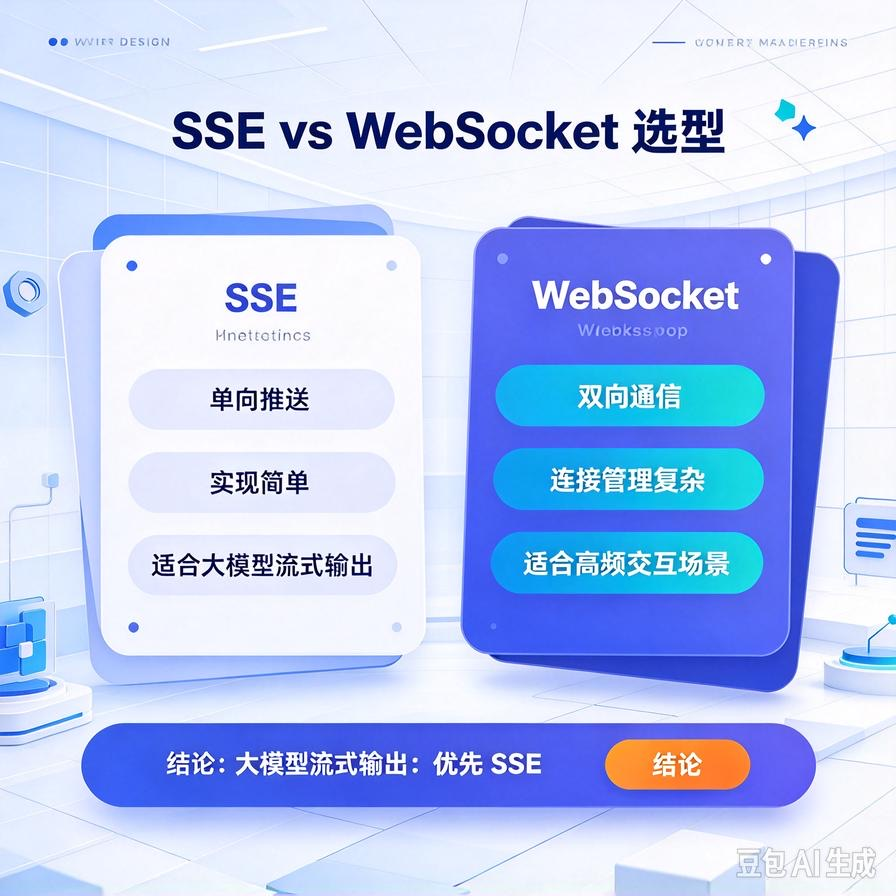
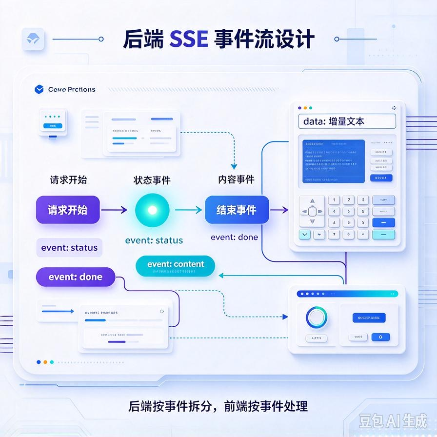
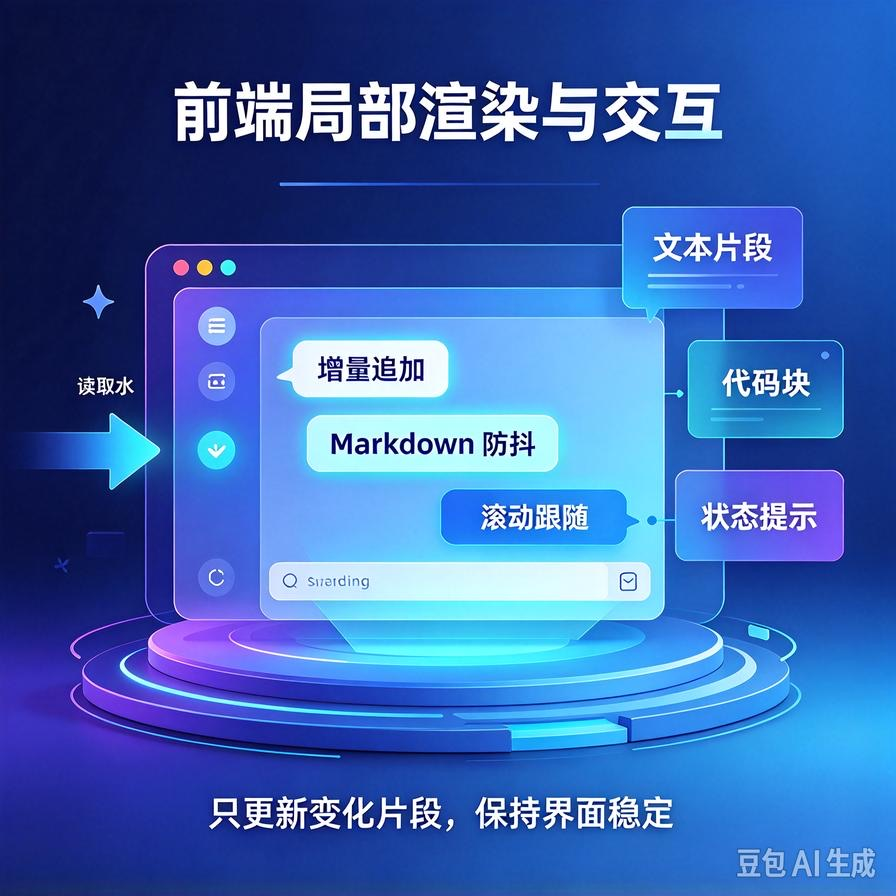
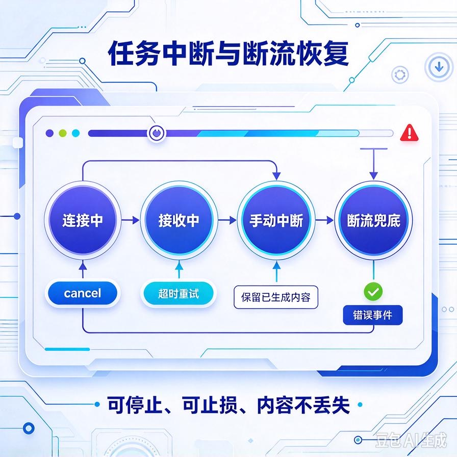

# 第62篇：流式输出工程落地 | SSE/WebSocket、局部渲染、任务中断控制
前面几篇我们把Agent的能力、评估、容错都搭好了。但还有一个非常影响用户感受的问题：**响应太慢了**。

用户问一个问题，Agent要先规划、再调工具、再检索、再生成，整个流程跑下来可能要10\~20秒。如果这10秒里用户看到的是一个转圈的加载图标，大部分人会直接关掉。但如果答案是一个字一个字蹦出来的，用户的耐心会完全不一样——这就是流式输出的价值。

这一篇专讲流式输出在工程上怎么落地：**SSE和WebSocket怎么选、后端怎么边生成边推、前端怎么局部渲染、用户想中途打断怎么处理、断流了怎么办**。文末附面试高频问答。

# 一、为什么必须流式输出

非流式的流程是：后端等大模型把整段答案生成完→一次性返回→前端渲染。用户等待时间=完整生成时间，中间毫无反馈。

流式输出的流程是：大模型生成一个词→立刻推给前端→前端立刻显示→继续生成下一个词→继续推。用户看到的效果是"打字机"，平均首字延迟从10秒降到1秒以内，体感速度提升一个量级。

对Agent来说流式更重要：因为Agent不只是生成答案，它中间还要调工具、检索知识库。流式输出能把"正在查订单""正在整理信息"这些中间过程也推给用户，让用户知道"它在干活"，而不是以为卡死了。

# 二、SSE vs WebSocket：怎么选



这是面试高频题，也是工程选型第一课。

| 维度 | SSE（Server-Sent Events） | WebSocket |
|-|-|-|
| **通信方向** | 服务端→客户端单向推送 | 全双工，双方随时互发 |
| **协议** | 基于HTTP，浏览器原生支持 | 独立协议（ws://），需握手升级 |
| **断线重连** | 浏览器自动重连，开箱即用 | 需自己实现重连逻辑 |
| **适用场景** | 大模型流式输出、日志推送、进度更新 | 实时聊天、协同编辑、游戏、高频双向交互 |
| **复杂度** | 低，几行代码就能跑 | 高，需处理连接管理、心跳、断线 |

结论非常明确：**大模型流式输出用SSE，不要用WebSocket**。因为场景本质是"服务端持续推数据给客户端"，客户端几乎不需要中途发数据（除了"停止"按钮）。SSE基于HTTP，穿透代理、鉴权、部署都简单；WebSocket是杀鸡用牛刀，还多一堆连接管理的坑。

# 三、后端怎么推：一个最小可用的SSE示例



```python
from fastapi import FastAPI
from fastapi.responses import StreamingResponse
import json

app = FastAPI()

@app.post("/chat/stream")
async def chat_stream(query: str):
    async def event_generator():
        # 先推一个状态：正在思考
        yield f"data: {json.dumps({"type": "status", "text": "正在检索知识库..."})}\n\n"

        # 调大模型，开启stream=True，逐chunk拿结果
        async for chunk in llm.astream(query):
            delta = chunk.choices[0].delta.content or ""
            if delta:
                yield f"data: {json.dumps({"type": "answer", "text": delta})}\n\n"

        # 最后推一个结束标记
        yield f"data: {json.dumps({"type": "done"})}\n\n"

    return StreamingResponse(event_generator(), media_type="text/event-stream")
```

关键点：**SSE的消息格式是固定的**——每行以"data: "开头，以两个换行符结束。前端用EventSource或fetch ReadableStream就能接。

工程上要推三类事件：

- **状态事件**："正在检索""正在调用工具"——让用户知道进度；
- **内容事件**：答案的增量文本——这是主体；
- **结束/错误事件**：done标记或错误信息——前端据此停止loading。

# 四、前端局部渲染：打字机效果



前端收到chunk后，不要整段重渲染，要做**增量追加**：

```javascript
const resp = await fetch("/chat/stream", {method: "POST", body: ...});
const reader = resp.body.getReader();
const decoder = new TextDecoder();
let answerEl = document.getElementById("answer");

while (true) {
    const {done, value} = await reader.read();
    if (done) break;
    // 解析SSE格式：data: {...}\n\n
    const text = decoder.decode(value);
    for (const line of text.split("\n\n")) {
        if (!line.startsWith("data: ")) continue;
        const data = JSON.parse(line.slice(6));
        if (data.type === "answer") {
            answerEl.textContent += data.text;  // 只追加，不重渲染整段
        } else if (data.type === "done") {
            // 结束，隐藏loading
        }
    }
}
```

三个工程细节：

- **Markdown渲染要防抖**：如果答案里有代码块、表格，每来一个chunk就重新渲染Markdown会很卡。攒一段（比如每500ms）再渲染一次。
- **滚动跟随**：新内容出来时自动滚到底部，但如果用户往上翻了就不要强行拽回来。
- **打字机光标**：最后一个字符后面跟一个闪烁光标，结束后光标消失。

# 五、任务中断：用户不想等了怎么办



用户问了个问题，Agent跑了10秒还没完，用户改主意了想换个问法——这时候必须能立刻停掉。

工程实现：

- **前端**：用户点"停止"按钮，调用`reader.cancel()`或发一个"stop"请求；
- **后端**：监听断开事件（FastAPI里是`await request.is_disconnected()`），一旦发现客户端断开，立刻取消大模型的流式请求、终止正在跑的工具调用；
- **关键**：不要因为客户端断了还在后台烧Token把整段生成完。每生成一个chunk前先检查一下连接是否还活着。

```python
async def event_generator(request, query):
    async for chunk in llm.astream(query):
        if await request.is_disconnected():
            break   # 用户已断开，立刻停止，不再浪费Token
        yield ...
```

# 六、断流与异常处理

流式输出最怕中间断了：大模型生成到一半超时、网络抖动、服务端崩溃。这时候前端不能傻等。

- **超时兜底**：SSE连接超过30秒没收到任何chunk，前端主动提示"响应超时"，让用户重试；
- **错误事件**：后端中途出错时，要主动推一个type:"error"的SSE事件，带友好提示，而不是默默断连；
- **已生成内容不丢**：如果生成到一半出错，已经推给前端的内容保留，在后面加一句"以上内容生成中断，请重试"，不要整段清空。

# 七、工程踩坑清单

- **用WebSocket做流式输出**：杀鸡用牛刀，SSE足够了，别给自己加连接管理的负担。
- **整段重渲染**：每个chunk都重新渲染整个Markdown页面，会卡顿。要增量追加+防抖渲染。
- **客户端断了还在后台跑**：不检测disconnect，用户已经关页面了，后端还在烧Token。
- **错误时默默断连**：前端不知道发生了什么，一直转圈。必须推error事件。
- **不推中间状态**：只推最终答案，用户不知道Agent在干嘛，10秒等待依然焦虑。把"正在检索/正在调工具"也推出去。
- **代理层缓冲**：Nginx默认会缓冲SSE响应，导致流式变成"攒一波推一波"。要关proxy_buffering。

# 📝 面试高频问答

## Q1：SSE和WebSocket区别？大模型流式输出用哪个？

答：SSE是基于HTTP的服务端单向推送，浏览器原生支持自动重连，部署简单；WebSocket是全双工协议，适合高频双向交互但连接管理复杂。大模型流式输出本质是服务端持续推内容给客户端，客户端中途几乎不发数据，所以用SSE就够了，简单、稳定、穿透代理容易。WebSocket留给实时聊天、协同编辑这类真双向场景。

## Q2：流式输出怎么实现"边生成边显示"？

答：后端调大模型时开启stream模式，每生成一个token chunk就通过SSE推给前端；前端用fetch ReadableStream逐段读取，把增量文本追加到DOM上（不要整段重渲染）。Markdown渲染做防抖，每攒一段再渲染一次，配合打字机光标和自动滚动，就是用户熟悉的体验。

## Q3：用户中途想停止生成，怎么处理？

答：前端点"停止"后取消读取并向后端发断开信号；后端每生成一个chunk前检查客户端是否已断开，一旦断开就立刻取消大模型请求、终止工具调用，不再继续烧Token。关键是不能让后台任务因为客户端走了还在继续跑。

## Q4：流式输出中途断了/出错怎么办？

答：后端出错时主动推一个error类型的SSE事件带友好提示，不要默默断连；前端设超时兜底，长时间没收到chunk就提示重试；已经推给前端的内容保留，在后面标注"生成中断"，不要整段清空。用户已经看到的内容不要丢。

## Q5：流式输出在Nginx后面不生效，可能是什么原因？

答：最常见的是Nginx默认开启响应缓冲（proxy_buffering），会把SSE响应攒在缓冲区里一次性发，导致前端体验成了"等半天蹦一大段"。需要在对应location关掉proxy_buffering、设置X-Accel-Buffering: no，并确保不开启gzip对SSE响应的压缩。

---

下一篇是这个技术专题模块的收官：**Agent生产级部署**——服务隔离、并发控制、日志埋点、灰度上线，把前面所有能力打包成一个能扛住真实流量的线上服务。

> 来源：头条号《AI Agent 零基础实战》第62篇｜版权归作者所有，仅供学习交流
