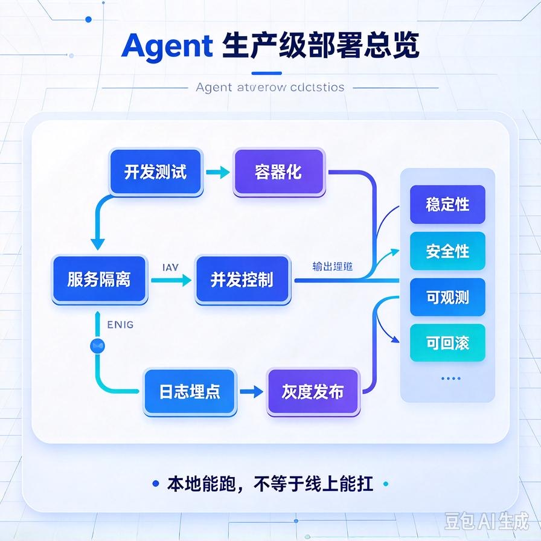
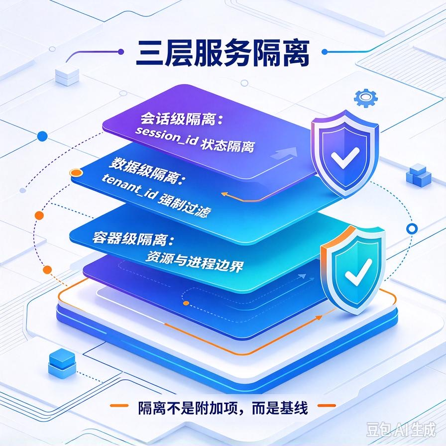
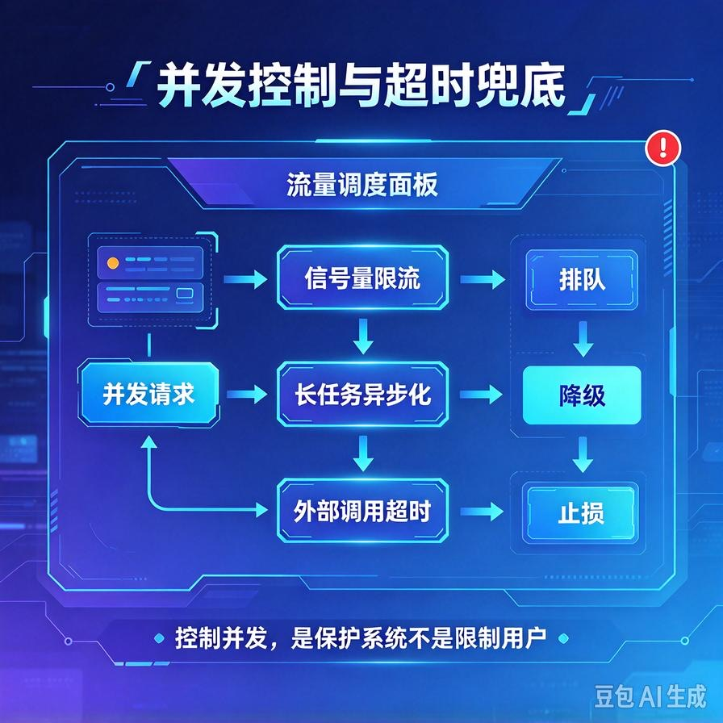
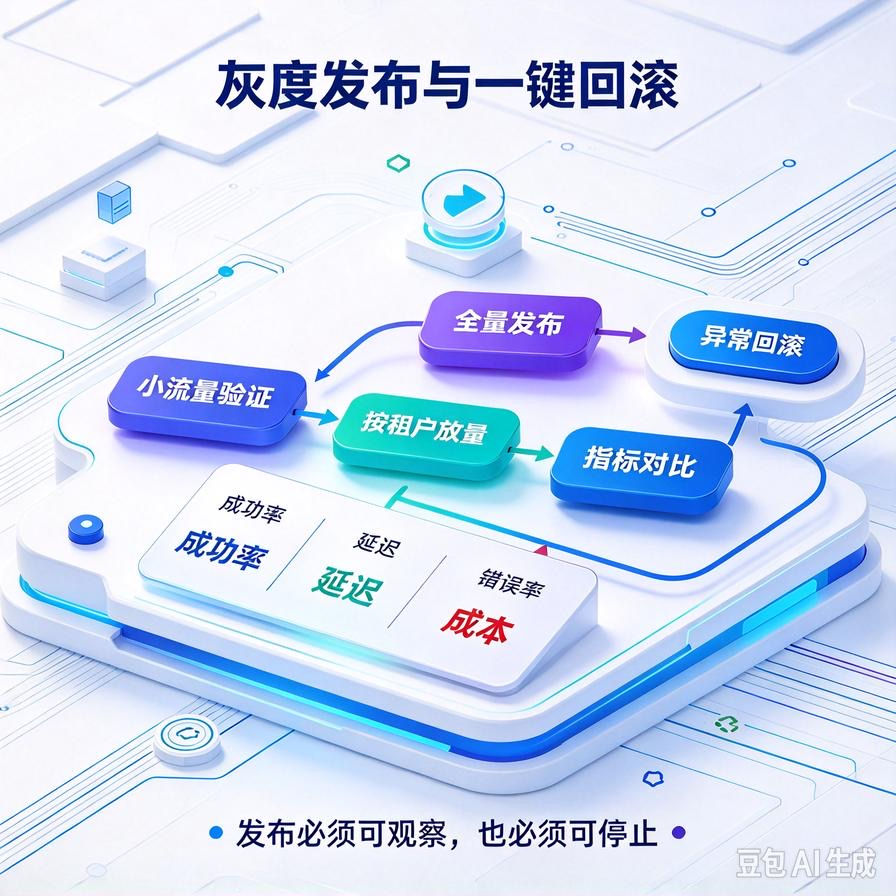

# 第63篇：Agent生产级部署 | 服务隔离、并发控制、日志埋点、灰度上线
欢迎回到 AI Agent 零基础实战·高阶技术专题。

从52篇到62篇，我们把Agent的架构、ReAct、工具调用、RAG进阶、多Agent协作、故障自愈、流式输出全部搭完了。代码在你本机跑着很顺，演示视频也拍得漂亮。但一旦把它真正部署到服务器、让真实用户同时访问，问题马上就来：两个客户的会话串了、内存蹭蹭往上涨、高峰期超时、出了问题你连哪一步挂的都不知道。

这一篇就是把Agent从"本地能跑"推向"线上能扛"的最后一公里。**核心讲四件事：服务怎么隔离、并发怎么控、日志怎么埋、新版本怎么灰度上线**。文末附面试高频问答。



# 一、为什么本地能跑不等于线上能扛

先把本地Demo和生产服务的差距摆清楚：

| 维度 | 本地Demo | 生产服务 |
|-|-|-|
| **并发** | 你一个人测，串行调用 | 几十个用户同时问，请求并发进来 |
| **数据** | 只有你自己的测试数据 | 多个客户的知识库、会话混在一起 |
| **故障** | 报错重启就好 | 不能停服，要快速定位、自动恢复 |
| **性能** | 慢一点无所谓 | 延迟、内存、成本都要可控 |

生产部署的本质，就是用工程手段把这四个差距全部补上。下面逐个拆。

# 二、服务隔离：别让一个客户的事故影响所有人



接单交付最常见的事故，就是多客户共用一套服务时"会话串了"：A客户问自己公司制度，Agent却答出了B客户的内部文档。这是隔离没做好。

## 1. 会话级隔离

每个请求进来，第一件事就是生成或读取一个唯一的session_id。**所有状态、对话历史、向量库查询都挂在这个session_id下**，绝不能用全局变量存用户状态：

```python
# ❌ 错误：全局变量，多用户直接串数据
current_user_state = {}

@app.post("/chat")
async def chat(query: str):
    current_user_state["history"].append(query)  # 所有人共用这一份

# ✅ 正确：状态按 session_id 隔离
@app.post("/chat")
async def chat(query: str, session_id: str):
    state = load_session(session_id)      # 从Redis/数据库读该会话专属状态
    state["history"].append(query)
    save_session(session_id, state)
```

## 2. 数据级隔离

多客户共用一个向量库时，每一条文档都要带上`tenant_id`。检索时强制加过滤条件，从根上杜绝跨客户召回。

```python
def search_kb(query, tenant_id):
    return vector_store.search(
        query,
        top_k=5,
        filter={"tenant_id": tenant_id}   # 必加，否则召回别人的文档
    )
```

## 3. 进程/容器级隔离

高敏感客户（比如金融、医疗）要求数据完全物理隔离，这时候不要硬塞进共享实例，而是给关键客户单独部署一个容器或独立进程。资源上用Docker限制CPU和内存，防止一个客户把整台机器吃满。

# 三、并发控制：别把大模型和服务器一起压垮



Agent服务有个特点：单次请求耗时长（要规划、要调工具、要生成），而且背后的大模型API有并发和限流。并发上来了不控，就是雪崩。

## 1. 限流：保护自己，也保护上游

用信号量限制同时在跑的请求数。超过的请求排队或快速失败，而不是无限堆进去把内存和上游额度打爆：

```python
import asyncio
semaphore = asyncio.Semaphore(10)   # 同时最多处理10个请求

@app.post("/chat")
async def chat(query: str, session_id: str):
    try:
        async with semaphore:        # 拿不到就排队
            return await run_agent(query, session_id)
    except asyncio.QueueFull:
        return JSONResponse({"error": "系统繁忙，请稍后再试"}, status_code=429)
```

## 2. 长任务异步化

超过30秒的复杂任务（比如批量入库、长报告生成）不要占着HTTP连接。丢进任务队列，立刻返回一个task_id，前端轮询或用SSE推送进度。这一点第70篇还会专门展开。

## 3. 超时兜底

每一个外部调用——大模型、工具、数据库——都必须设超时。没有超时的等待，是生产环境最隐蔽的资源泄漏。

# 四、日志埋点：出了问题能快速定位

线上Agent出问题，90%的新手第一反应是"我本地明明是好的"。没有日志，你永远不知道线上到底发生了什么。

生产环境必须给每一次请求打一条完整链路日志，核心字段：

- **trace_id**：一次请求一个唯一ID，贯穿这次Agent的所有步骤；
- **session_id / tenant_id**：知道是哪个客户、哪个会话；
- **每一步耗时与Token消耗**：规划多久、检索多久、生成多久；
- **工具调用明细**：调了哪个工具、传了什么参数、返回什么；
- **最终用的模型版本、Prompt版本**：方便回滚对比。

```json
{
  "trace_id": "tr_8f3a21",
  "tenant_id": "client_a",
  "session_id": "sess_001",
  "steps": [
    {"step": "retrieve", "ms": 320, "tokens_in": 1200},
    {"step": "call_tool",   "tool": "get_order", "ms": 500},
    {"step": "generate",   "ms": 2400, "tokens_out": 350}
  ],
  "model": "gpt-4o-mini",
  "total_ms": 3220
}
```

有了这个，线上客户投诉"答非所问"，你拿trace_id一查，立刻知道是召回没召对、工具调错了、还是生成跑偏了。这是商用运维的基本功。

# 五、灰度上线：新版本别一次全量推



你改了Prompt、换了模型、调了RAG参数，效果在测试集上变好了。但直接全量推给所有客户，万一在线上翻车，就是集体事故。

正确的发布方式是灰度：

- **先内部/小流量**：新版本只切给你自己或1\~2个测试客户观察；
- **按租户分流**：稳定跑几天后，再放给低风险客户，最后才全量；
- **一键回滚**：新旧版本并行部署，发现问题立刻把流量切回旧版本，几分钟恢复；
- **指标对比**：灰度期间盯着任务完成率、错误率、延迟，和旧版本对比，数据不掉再继续放量。

配合第60篇的评测体系：每次上线前跑一遍核心回归集，线上灰度时盯核心指标——这就是Agent版本的"CI/CD"。

# 六、工程踩坑清单

- **用全局变量存会话状态**：多用户并发直接串数据，这是最致命的错误。状态必须按session_id隔离。
- **检索不带租户过滤**：多客户知识库混用，必然召回别人的文档。
- **不设并发上限**：高峰期请求堆积，内存和上游API一起被打挂。
- **外部调用不设超时**：一个慢调用拖死整个worker。
- **没有trace_id**：线上出问题像无头苍蝇，查半天定位不到环节。
- **改完直接全量发布**：没有灰度、没有回滚，一次翻车就是客户事故。

# 📝 面试高频问答

## Q1：把Agent从Demo部署到生产，你会做哪些事？

答：核心四块。服务隔离——会话状态按session隔离、向量库按租户过滤、关键客户独立容器；并发控制——信号量限流、长任务异步化、外部调用超时；可观测性——全链路trace_id日志，记录每步耗时、Token、工具调用；发布——灰度切流、新旧版本并行、指标对比、一键回滚。本质是解决并发、隔离、故障定位和安全发布四件事。

## Q2：多用户同时访问，怎么避免会话串数据？

答：绝不用全局变量存状态。每个请求以session_id（多租户再加tenant_id）为key，会话历史、上下文、知识库检索全部挂在这个key下，从Redis/数据库按key读写。向量库检索强制加tenant_id过滤，物理隔离的大客户单独部署实例。

## Q3：Agent服务怎么做限流和并发控制？

答：用信号量限制同时在跑的请求数，超出就排队或返回429；长耗时任务丢异步队列、返回task_id让前端轮询；每个外部调用（大模型、工具、DB）都设超时，防止慢调用拖垮worker。目的是在有限资源和上游API额度下，保证服务不雪崩。

## Q4：线上Agent出了问题怎么快速定位？

答：靠全链路日志。每次请求一个trace_id，贯穿规划、检索、工具调用、生成每一步，记录耗时、Token、工具参数、模型版本。客户反馈问题时拿trace_id反查，看是召回错、工具错、还是生成错，哪一环掉链子修哪一环，而不是凭感觉猜。

## Q5：新版本Prompt或模型怎么安全上线？

答：灰度发布。先内部和小流量客户验证，按租户逐步放量，新旧版本并行部署以便一键回滚；上线前跑核心回归评测集，灰度期间盯任务完成率、错误率、延迟并与旧版对比，指标不掉才全量。避免一次全量发布把所有客户带进沟里。

---

下一篇：**第64篇｜Agent状态机深度工程**，专门解决多轮长任务的会话持久化和状态流转问题。

> 来源：头条号《AI Agent 零基础实战》第63篇｜版权归作者所有，仅供学习交流
