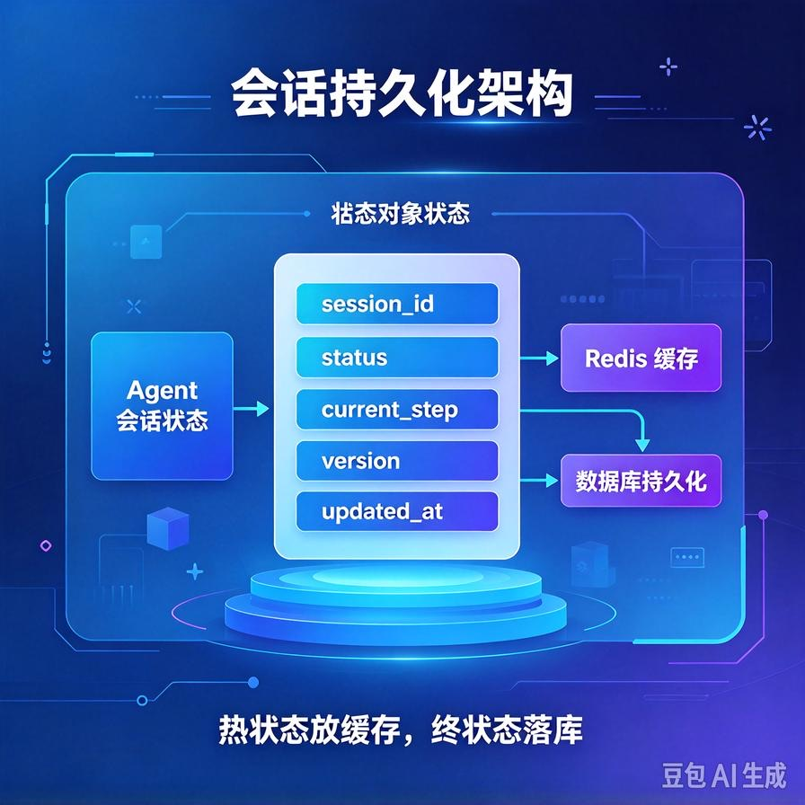
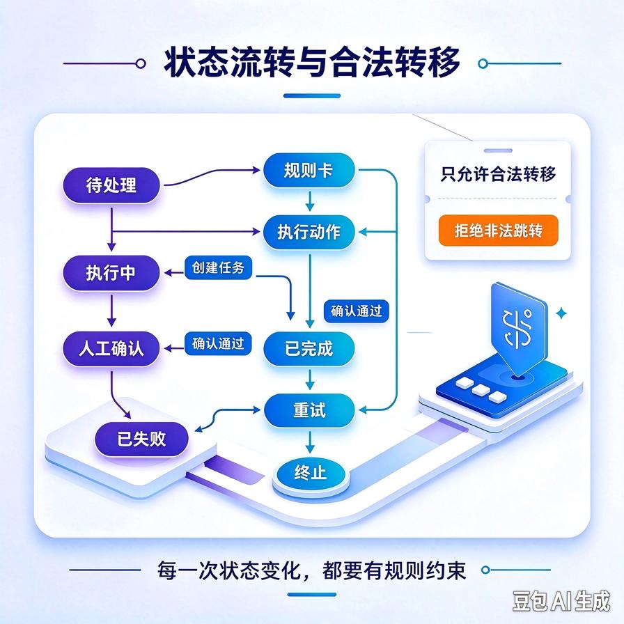

# 第64篇：Agent状态机深度工程 | 会话持久化、状态流转与脏状态清理
欢迎进入模块四「Agent进阶深挖与面试硬核」。

先看一个真实的线上事故：客户在你的客服Agent里走"申请退款"流程，第一步填了订单号、第二步点了确认，结果中途网络断了。用户重连后，Agent一脸茫然地问"请问您要办什么业务"——前面填的订单号全没了。更糟的是，有人刷新页面后又走了一遍流程，结果同一笔退款被提交了两次。

这就是没有状态机的下场。前面61篇我们讲了任务回滚和断点续跑，但那只是"崩了之后怎么办"。这一篇要讲得更底层：**Agent的状态到底该怎么设计、怎么持久化、怎么流转、以及那些卡住不动的脏状态怎么清理**。文末附面试高频问答。

# 一、为什么Agent需要状态机


很多新手把Agent当成"一问一答"的无状态服务：每次请求把历史对话拼进Prompt就完事。这在简单问答里够用，但一旦任务是**多步、跨多次对话、有先后顺序**的（退款、开户、审批、表单收集），无状态就崩了。

状态机的本质是：**把一个长任务拆成有限个明确状态，每个状态知道"我现在在哪、下一步能去哪、到了该做什么"**。它带来三个好处：

- **可恢复**：用户中途断了，重连后从当前状态接着走，不用重来；
- **防错乱**：没填订单号就不能跳到"确认退款"，状态机把非法跳转直接拦住；
- **可审计**：每个任务走到哪一步、卡在哪，一目了然。

# 二、状态机怎么设计：状态、转移、动作

一个状态机就三样东西：**状态集合、转移规则、每个状态要做的动作**。以"退款申请"为例：

```text
INIT（初始化）
  → 收集订单号 COLLECT_ORDER
  → 校验订单 VERIFY_ORDER
  → 用户确认 CONFIRM
  → 执行退款 REFUNDING
  → 完成 DONE
任意状态 → 失败 FAILED / 用户取消 CANCELLED
```

关键设计原则：**状态要少而明确**，不要把每个中间思考都定义成一个状态。状态只在"对外有意义、需要持久化"的节点上打标记。

# 三、会话持久化：状态存哪、存什么



状态机要能恢复，前提是状态持久化了。生产环境不要把状态放内存——重启就全没了。

## 1. 存什么

```python
{
  "session_id": "sess_001",
  "tenant_id": "client_a",
  "current_state": "COLLECT_ORDER",   # 当前状态
  "context": {                           # 该任务已收集的数据
      "order_id": "ORD-20240815",
      "reason": "商品破损"
  },
  "version": 3,                          # 乐观锁版本号
  "updated_at": 1730000000
}
```

注意：**只持久化"业务关键数据"，不要把大模型的每次中间思考都存下来**。上下文历史可以单独存，但任务状态要精简。

## 2. 存哪

| 存储 | 适用 | 注意 |
|-|-|-|
| **Redis** | 会话状态、短期上下文、需要快速读写 | 设过期时间，别永久堆 |
| **数据库** | 已完成的任务、需要审计和追溯的 | 持久化落盘，防重启丢 |

经验做法：**活跃会话放Redis，任务完成或超时后归档到数据库**。Redis保证快，数据库保证不丢。

# 四、状态流转：怎么防止跳步和并发错乱



## 1. 合法转移才放行

用户在CONFIRM状态下，只能走向REFUNDING或CANCELLED。想从COLLECT_ORDER直接跳到REFUNDING？状态机直接拒绝，提示"请先完成订单校验"。这就从根上防止了乱流程。

```python
TRANSITIONS = {
    "INIT":          ["COLLECT_ORDER"],
    "COLLECT_ORDER": ["VERIFY_ORDER", "CANCELLED"],
    "VERIFY_ORDER":  ["CONFIRM", "COLLECT_ORDER", "FAILED"],
    "CONFIRM":       ["REFUNDING", "CANCELLED"],
    "REFUNDING":     ["DONE", "FAILED"],
}

def can_transit(current, target):
    return target in TRANSITIONS.get(current, [])
```

## 2. 乐观锁防并发覆盖

用户手抖点两次确认、或者网络重试，可能两个请求同时改一个状态。用version字段做乐观锁：更新时带上旧version，版本对不上就拒绝，防止"后写覆盖先写"导致重复退款。

# 五、脏状态清理：卡住的会话别占着资源


线上最隐蔽的问题：大量会话停在中间状态再也不动了——用户走到一半关了页面、网络断了、流程卡住。这些"僵尸会话"会一直占着Redis内存，还可能造成重复提交。必须主动清理。

- **过期自动过期**：会话状态在Redis设TTL（比如30分钟无活动自动过期），过期后任务回滚到可重试或终止；
- **超时任务兜底**：后台定时扫描卡在某个状态超过阈值的任务（比如REFUNDING卡了10分钟），查一下外部系统到底成没成功，把状态修正到DONE或FAILED；
- **死状态告警**：同一用户重复发起同一任务、或状态长时间不前进，打日志并告警，人工介入。

```python
def sweep_stale_sessions():
    stale = redis.keys("sess:*")  # 扫描所有会话
    for key in stale:
        state = load_state(key)
        # 卡在中间状态超过30分钟
        if state["current_state"] not in ["DONE", "CANCELLED", "FAILED"] \
           and time.time() - state["updated_at"] > 1800:
            reconcile(state)   # 查外部系统真实状态后修正
            archive_to_db(state)
            redis.delete(key)
```

# 六、工程踩坑清单

- **状态只放内存**：服务一重启，所有进行中的任务全丢。活跃状态也得落Redis/DB。
- **状态定义太细**：把每次模型思考都存成一个状态，状态机爆炸、维护不动。只在对外关键节点打状态。
- **不校验状态转移**：随便跳步，流程逻辑全靠模型自觉，必然出乱子。
- **并发更新不加锁**：重复提交、重复退款就这么来的。用version乐观锁。
- **僵尸会话不清理**：Redis内存被慢慢吃满，过期任务还可能被误重试。
- **状态和外部系统不一致**：退款接口其实成功了，但本地状态还停在REFUNDING，要靠对账/兜底扫描修正。

# 📝 面试高频问答

## Q1：为什么Agent需要状态机，不能用Prompt拼接历史吗？

答：简单问答可以。但多步、跨轮次、有先后顺序的任务（退款、审批、表单收集）需要状态机：它把任务拆成有限明确的状态，保证不跳步、断了能恢复、全程可审计。Prompt拼历史只是"记上下文"，管不了"现在走到哪一步、下一步合法吗"，这是本质区别。

## Q2：会话状态存在哪里？怎么设计？

答：别放内存（重启即丢）。活跃会话状态放Redis保证快速读写并设TTL，已完成或重要任务归档到数据库持久化审计。状态对象只存业务关键数据（当前状态、已收集字段、版本号、时间戳），不存大模型每次中间思考。

## Q3：怎么防止用户重复提交导致重复退款？

答：两层。一是状态机校验——已到CONFIRM/REFUNDING的任务不能重复进入；二是乐观锁——更新状态时带version，版本对不上就拒绝，防止并发请求互相覆盖。对真正的写操作还要靠外部接口幂等（同一请求号只生效一次）兜底。

## Q4：用户走到一半断开了，怎么续上？

答：状态已持久化在Redis/DB里，用户重连时凭session_id读回current_state和已收集的context，从当前状态接着引导，而不是从头再来。比如退款流程断了，重连时直接说"请确认刚才的订单退款"，而不是重新问订单号。

## Q5：怎么处理卡住不动的僵尸会话？

答：Redis设TTL让闲置会话自动过期；后台定时扫描卡在中间状态超过阈值的任务，对账外部系统真实状态后修正到DONE/FAILED，再归档清理；长期不前进或重复发起的会话告警人工介入。核心是让状态最终和外部系统一致，不留脏数据。

---

下一篇继续深挖：**第65篇｜LLM输出结构化约束实战**——怎么强制大模型稳定输出JSON、解析失败怎么自动修复，解决Function Calling返回乱格式的老大难问题。

> 来源：头条号《AI Agent 零基础实战》第64篇｜版权归作者所有，仅供学习交流
