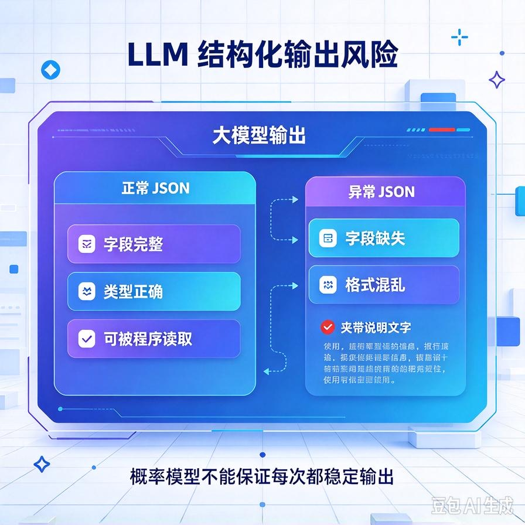
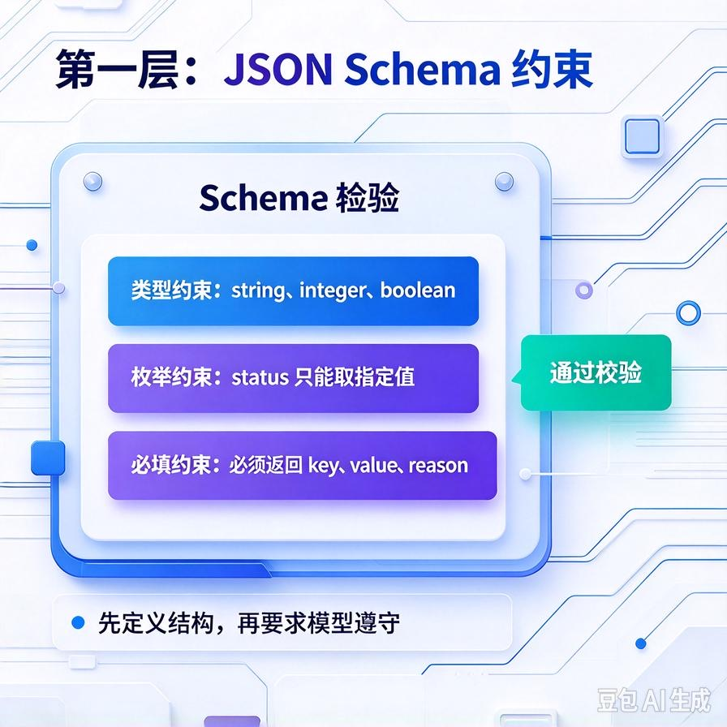
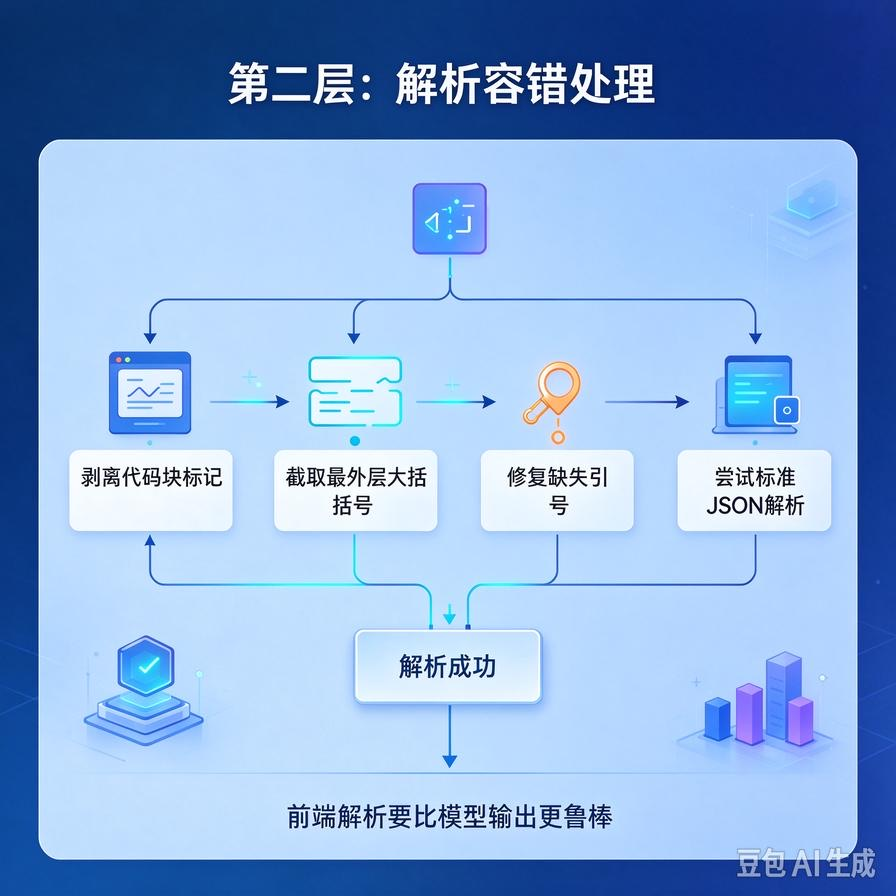
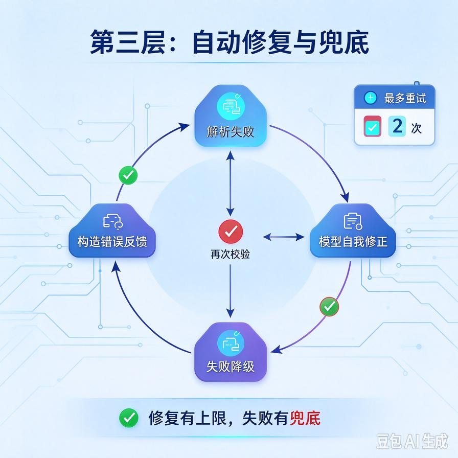

# 第65篇：LLM输出结构化约束实战 | JSON Schema、语法容错、修复与解析兜底
欢迎回到模块四「Agent进阶深挖与面试硬核」。

做Agent的人都被同一个问题折磨过：你明明在Prompt里写了"请输出严格的JSON"，结果大模型要么前后加了一大段废话解释、要么用\`\`\`json代码块包着、要么多个逗号对不上引号、要么字段名自己瞎改。你的解析器一json.load直接抛异常，整个流程崩给用户看。

这就是"大模型输出不可控"的老大难。Function Calling为什么出现？就是为了解决它。但即便用了Function Calling，模型照样会偶发返回不合法格式。这一篇专讲：**怎么用JSON Schema约束输出、解析失败怎么自动容错修复、以及解析彻底失败怎么兜底**。文末附面试高频问答。

# 一、问题根源：为什么模型输出不总是合法JSON



大模型本质是"一个字一个字往下猜"的概率模型，它不是在执行程序。所以它输出JSON时出错是常态：

- **夹带解释**："好的，以下是结果：{...}"——前后多了自然语言；
- **格式包装**：用\`\`\`json ... \`\`\`代码块包着，甚至加注释；
- **语法错误**：尾逗号、缺引号、单双引号混用；
- **字段漂移**：让它输出"order_id"，它写成"orderId"或"订单号"。

新手的做法是反复在Prompt里强调"请一定输出合法JSON"——没用，概率模型改不了根。工程上要靠"约束 + 容错 + 兜底"三层来保证。

# 二、第一层：用Schema把输出钉死



最可靠的方式不是求模型，而是用结构化输出能力直接约束。现代大模型API普遍支持**JSON Schema / Function Calling**：你告诉它要什么结构，它的采样过程就被约束成只能输出这个结构。

```python
response = client.chat.completions.create(
    model="gpt-4o-mini",
    messages=[{"role": "user", "content": query}],
    response_format={
        "type": "json_schema",
        "json_schema": {
            "name": "order_intent",
            "schema": {
                "type": "object",
                "properties": {
                    "intent": {"type": "string",
                                "enum": ["query_order", "refund", "other"]},
                    "order_id": {"type": "string"}
                },
                "required": ["intent"]
            }
        }
    }
)
```

Schema三个关键作用：**定类型、定枚举、定必填**。用enum把intent限定死，模型就不会自由发挥；required保证必填字段不缺。这一层能把格式错误率压到很低。

注意：不是所有模型都支持严格Schema。用小模型或开源模型时，退而求其次用Function Calling，或在Prompt里给一个填好的示例（few-shot），效果也比空口要求好。

# 三、第二层：语法容错——解析前先清洗



即使有Schema，你也永远不能假设模型100%输出干净JSON。解析前要做一轮"清洗容错"：

````python
import json, re

def safe_parse_json(text):
    # 1. 剥离 ```json ... ``` 代码块
    text = re.sub(r"^```(json)?", "", text.strip())
    text = re.sub(r"```$", "", text.strip())
    # 2. 截取第一个 { 到最后一个 } 之间的内容，甩掉前后废话
    start, end = text.find("{"), text.rfind("}")
    if start != -1 and end != -1:
        text = text[start:end+1]
    try:
        return json.loads(text)
    except json.JSONDecodeError:
        return None
````

这几步能救回80%的"格式小毛病"：代码块包装、前后废话、尾逗号。剩下真解析不了的，才进入下一层。

# 四、第三层：自动修复——让模型自己改对



清洗后还是解析失败，不要直接报错给用户。把"原始输出 + 报错信息"回喂给模型，让它自己修：

```python
def parse_with_repair(raw_text, max_retry=2):
    for i in range(max_retry):
        parsed = safe_parse_json(raw_text)
        if parsed is not None:
            return parsed
        # 没解析出来，把错误回喂让模型修
        raw_text = client.chat.completions.create(
            model="gpt-4o-mini",
            messages=[
                {"role":"user","content":
                 f"下面不是合法JSON，请修正为严格可解析的JSON，不要加任何解释：\n{raw_text}"}
            ]
        ).choices[0].message.content
    return None   # 真修不好，走兜底
```

这个"自我修复"通常一两轮就能成功。但要设重试上限（最多2次），否则模型可能越改越乱、白白烧Token。

# 五、字段校验与兜底

解析成功不等于可用。拿到JSON后还要做业务校验：必填字段在不在、枚举值合不合法、类型对不对。校验不过，按缺的字段补问用户或走默认值。

三层都走完还是失败？那就兜底：**记录原始输出日志、给用户友好提示、转人工或用默认逻辑**。绝不能把一个裸的JSON解析错误抛给终端用户。

```python
def structured_extract(query):
    raw = call_llm(query)                 # 1. 模型输出
    data = parse_with_repair(raw)         # 2. 清洗+修复
    if data is None or "intent" not in data:
        log_failure(query, raw)           # 留痕
        return {"intent": "other",
                "reply": "抱歉，我没太理解，您可以换个说法或转人工"}
    return data
```

# 六、工程踩坑清单

- **只靠Prompt要求"输出JSON"**：概率模型靠不住，必须上Schema/Function Calling。
- **json.load直接裸调**：模型输出带代码块或废话就崩，一定要先清洗。
- **解析失败就抛错**：用户看到堆栈，体验极差。要自动修复+兜底话术。
- **不校验业务字段**：JSON合法但intent是"我瞎编的"，照样出错。解析后必须按Schema校验字段。
- **修复不设上限**：模型可能越修越乱，重试最多2\~3次就兜底。
- **不留原始日志**：解析失败时原始输出是定位问题的唯一线索，必须存下来。

# 📝 面试高频问答

## Q1：怎么让大模型稳定输出合法JSON？

答：三层防护。优先用结构化输出能力（JSON Schema / Function Calling），在采样层就把格式钉死（定类型、枚举、必填）；其次解析前做容错清洗，剥离代码块、截取大括号、容错常见语法错误；最后清洗还失败就把原始输出回喂让模型自我修复，重试2\~3次。绝不能裸调json.load。

````python
import json
from openai import OpenAI

client = OpenAI()

def strip_code_block(raw_text: str) -> str:
    """第二层：清洗代码块和多余文字"""
    import re
    text = re.sub(r"```(?:json)?\s*", "", raw_text)
    text = re.sub(r"\s*```", "", text)
    start, end = text.find("{"), text.rfind("}")
    return text[start:end+1].strip() if start != -1 and end > start else text

def robust_json_parse(user_query: str, max_retry: int = 3) -> dict:
    # 第一层：response_format 强制 JSON 模式
    resp = client.chat.completions.create(
        model="gpt-4o",
        messages=[{"role": "user", "content": user_query}],
        response_format={"type": "json_object"},
        temperature=0,
    )
    cleaned = strip_code_block(resp.choices[0].message.content)

    # 第三层：解析失败则回喂模型自我修复
    for _ in range(max_retry):
        try:
            return json.loads(cleaned)
        except json.JSONDecodeError:
            repair = client.chat.completions.create(
                model="gpt-4o",
                messages=[{"role": "user",
                    "content": f"以下JSON有语法错误，只输出修复后的合法JSON：\n{cleaned}"}],
                response_format={"type": "json_object"},
            )
            cleaned = strip_code_block(repair.choices[0].message.content)
    raise ValueError("JSON解析失败，已达最大重试次数")
````

## Q2：为什么Prompt里反复要求"输出JSON"还是不稳定？

答：因为大模型是概率生成模型，不是在执行程序，它天然会夹带解释、加代码块、偶尔语法错误。Prompt强调只能降低概率，不能消除。工程上要接受"它一定会偶尔出错"，用Schema约束+解析容错+自动修复来兜住，而不是迷信Prompt。

```python
# ❌ 差的 Prompt —— 只靠嘴说，模型经常不遵守
bad_prompt = """
请输出一个用户信息，要求JSON格式。
"""
# 模型可能返回：
# "好的，这是用户信息：\n{\n  \"name\": \"张三\"\n}"
# —— 带解释文字，还可能缺字段，你得自己猜着补

# ✅ 可靠的 Prompt —— 明确字段 + 配合 response_format
good_prompt = """
你是一个信息提取器，只输出JSON对象，禁止输出任何解释文字。
必须包含以下字段：
- name: 姓名（字符串，必填）
- age: 年龄（整数，必填）
- city: 城市（字符串，选填，缺省填"未知"）
从下面的用户输入中提取：
{user_input}
"""
# 调用时加上：response_format={"type": "json_object"}
# 两道保险叠加，不稳定率从 ~15% 降到 <1%
```

## Q3：模型返回的JSON前后带解释文字或代码块怎么办？

答：解析前先清洗：正则去掉\`\`\`json标记，截取第一个{到最后一个}之间的内容，再json.loads。这一步能救回大部分格式小毛病。清洗失败再走自我修复，而不是直接报错。

````python
import re
import json

def extract_json(raw_text: str) -> dict:
    """从模型乱七八遭的输出中抢救出JSON"""
    # 1. 去掉 ```json ... ``` 或 ``` ... ``` 包裹
    text = re.sub(r"```(?:json|JSON)?\s*", "", raw_text)
    text = re.sub(r"\s*```", "", text)

    # 2. 截取第一个 { 到最后一个 } 之间的内容
    start = text.find("{")
    end = text.rfind("}")
    if start == -1 or end == -1 or end <= start:
        raise ValueError("未找到JSON对象")
    text = text[start:end + 1]

    # 3. 容错常见小毛病：尾逗号、单引号
    text = re.sub(r",\s*([}\]])", r"\1", text)  # 去掉尾逗号
    text = text.replace("'", "\"")  # 单引号转双引号

    return json.loads(text)

# 使用示例
raw = "好的，结果如下：\n```json\n{\"result\": 42, \"status\": \"ok\",\n}\n```\n希望对你有帮助！"
data = extract_json(raw)
print(data)  # {'result': 42, 'status': 'ok'}
````

## Q4：解析出来了但字段不对或缺字段，怎么处理？

答：解析成功不等于可用。拿到JSON后按Schema做业务校验：必填字段在不在、枚举值合不合法、类型对不对。缺了关键信息就补问用户，非关键字段用默认值，完全不合格就兜底话术转人工。

```python
from pydantic import BaseModel, field_validator, ValidationError

class UserInfo(BaseModel):
    name: str
    age: int
    city: str = "未知"          # 选填字段，给默认值兜底
    vip_level: str = "normal"

    @field_validator("age")
    def age_reasonable(cls, v: int) -> int:
        if v < 0 or v > 150:
            raise ValueError(f"年龄不合法: {v}")
        return v

    @field_validator("vip_level")
    def vip_enum(cls, v: str) -> str:
        allowed = {"normal", "silver", "gold", "platinum"}
        if v not in allowed:
            return "normal"   # 非法枚举值降级为默认
        return v

def parse_user(raw: dict):
    try:
        user = UserInfo(**raw)
        return user.model_dump(), None
    except ValidationError as e:
        # 关键字段缺失 → 触发补问；非关键字段 → 用默认值
        missing = [err["loc"][0] for err in e.errors() if err["type"] == "missing"]
        return None, f"缺少必填字段: {missing}，请补问用户"

# 测试：模型返回的 JSON 缺 city、age 离谱、vip_level 瞎写
bad_data = {"name": "张三", "age": 999, "vip_level": "钻五"}
result, err = parse_user(bad_data)
print(err)     # None（缺的是选填，不报错）
print(result)  # {'name':'张三', 'age':999, 'city':'未知', 'vip_level':'normal'}
```

## Q5：Function Calling和JSON Schema是什么关系？

答：本质都是结构化输出约束。Function Calling让模型在对话中决定调用哪个函数、填什么参数；JSON Schema则是直接约束一次输出的JSON结构。二者都是在模型层强制格式，比纯Prompt可靠得多。生产环境优先用它们，而不是让模型自由生成文本再赌它格式正确。

```python
from openai import OpenAI
import json

client = OpenAI()

# 定义工具 —— parameters 本身就是一份 JSON Schema
tools = [{
    "type": "function",
    "function": {
        "name": "get_weather",
        "description": "查询指定城市的天气",
        "parameters": {                    # ← 这就是 JSON Schema
            "type": "object",
            "properties": {
                "city": {"type": "string", "description": "城市名，如：北京"},
                "unit": {"type": "string",
                          "enum": ["celsius", "fahrenheit"]}
            },
            "required": ["city"]
        }
    }
}]

resp = client.chat.completions.create(
    model="gpt-4o",
    messages=[{"role": "user", "content": "北京今天天气怎么样？"}],
    tools=tools,
    tool_choice="auto"   # 让模型自己决定调不调、传什么参数
)

# 模型严格按 Schema 输出函数调用，参数一定是合法 JSON
call = resp.choices[0].message.tool_calls[0]
args = json.loads(call.function.arguments)
print(call.function.name)  # get_weather
print(args)                 # {'city': '北京', 'unit': 'celsius'}

# 对比：裸 Prompt 让模型自己说"我想查北京天气"，你还得用 NLP 去解析它想干嘛
# Function Calling 直接把意图 + 参数结构化给你，省掉所有猜测
```

---

下一篇是商用项目的硬骨头：**第66篇｜Agent安全攻防实战**——提示词注入、间接Prompt劫持、怎么防止用户用一句话把你的Agent带跑偏、泄露内部数据。这是企业客户验收必问的安全问题。

> 来源：头条号《AI Agent 零基础实战》第65篇｜版权归作者所有，仅供学习交流
