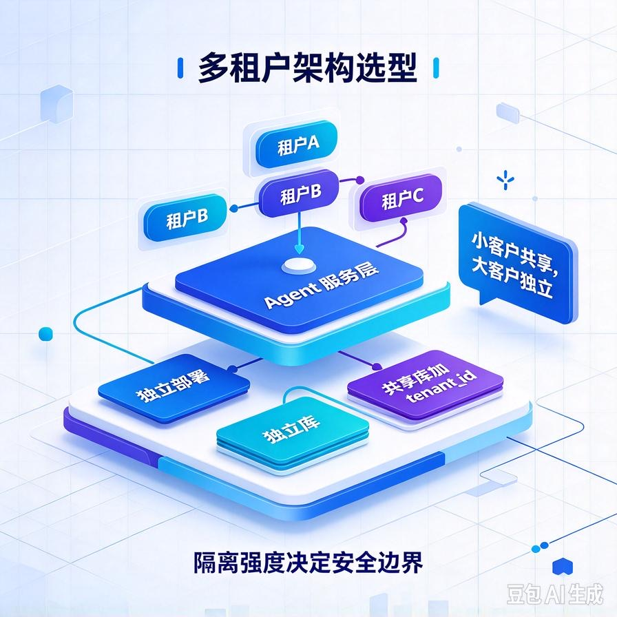
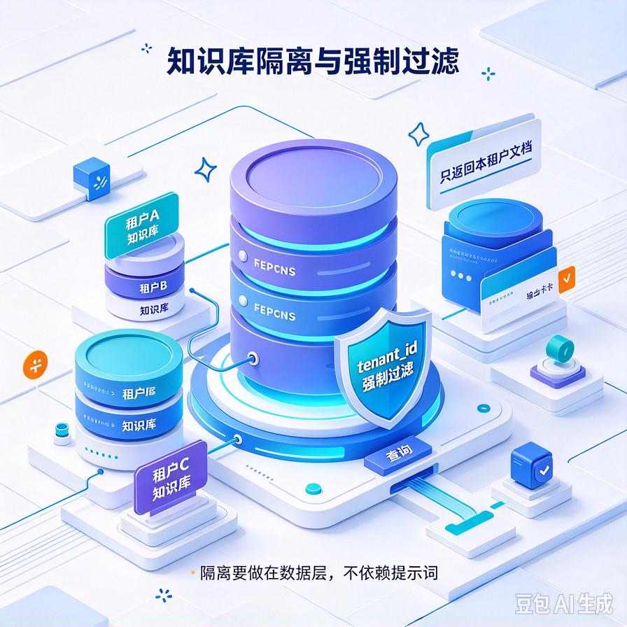
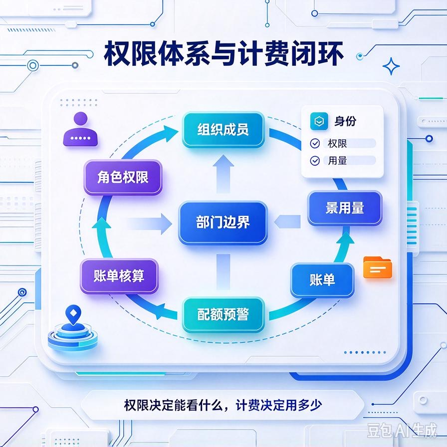

# 第67篇：多租户隔离工程设计 | 知识库隔离、资源配额、数据权限与计费隔离

欢迎回到模块四「Agent进阶深挖与面试硬核」。

前面66篇我们都是围绕"给一个客户做一个Agent"展开的。但接单做到后面你会发现一个更赚钱的模式：**把同一套Agent产品化，同时卖给几十个、上百个客户**。这就是从"接项目"升级成"做SaaS"。

可一旦多客户共用一套服务，新问题立刻出现：A客户不能看到B客户的知识库、一个大客户不能把API额度占光连累所有人、账单要能按客户单独算。这就是多租户隔离。这一篇专讲：**知识库怎么隔离、资源怎么配额、权限怎么控、计费怎么分账**。文末附面试高频问答。

# 一、三种多租户架构，先选对路线



多租户不是一种方案，是个谱系，隔离程度和成本成反比。

| 模式 | 怎么隔离 | 适用 |
|-|-|-|
| **独立部署** | 每个客户一套独立服务+独立库，完全物理隔离 | 金融、医疗等强合规大客户，客单价高 |
| **共享服务+独立库** | 同一套代码，每个客户独立数据库/向量库 | 中型客户，隔离与成本折中 |
| **共享库+租户字段** | 所有客户共用一个库，用tenant_id字段区分 | 小客户、走量SaaS，成本最低 |

接单实战里常见的组合拳：**小客户走共享库（便宜、快速上线），大客户单独开实例（安全、高客单）**。下面重点讲最常用的共享库模式怎么做好隔离。

# 二、知识库隔离：数据不能串


这是多租户最致命的红线——A客户问问题，绝不能召回B客户的文档。

## 1. 向量库强制租户过滤

第63篇提过，这里再强调一次：每条入库文档都带tenant_id，检索时这是**必加、不可绕过**的过滤条件。

```python
def search(query, tenant_id):
    if not tenant_id:
        raise PermissionError("缺少租户标识")
    return vector_db.search(
        query, top_k=5,
        filter={"tenant_id": tenant_id}   # 硬过滤，不可被prompt绕过
    )
```

关键认知：**不能靠Prompt告诉模型"你只服务A客户"**，模型可能被带偏。隔离必须做在数据层，是代码强制的，模型管不着。

## 2. 库级隔离更稳

对高敏感客户，直接给独立的向量库collection，从物理上就不在一起，比字段过滤更让人放心。

# 三、资源配额：别让一个客户拖垮所有人



共享服务最大的风险是" noisy neighbor（吵闹邻居）"——某客户业务高峰，疯狂调用，把CPU、内存、大模型API额度全占了，其他客户跟着卡死。

按租户做配额：

- **并发配额**：每个租户同时进行的请求数设上限，超了排队或拒绝；
- **调用次数配额**：按套餐限制每日/每月调用次数，防止刷爆；
- **Token配额**：统计每个租户的Token消耗，超额告警或限流；
- **知识库容量配额**：限制每个客户最多入库多少文档/多少MB。

```python
def check_quota(tenant_id):
    used = redis.get(f"token:{tenant_id}") or 0
    limit = plan_quota(tenant_id)   # 按套餐返回额度
    if used >= limit:
        raise QuotaExceeded("本月额度已用完，请升级套餐")
    return True
```

# 四、数据权限：租户内还要分角色



隔离不只是"租户之间"，一个租户内部也要分权。企业客户的真实场景：客服能查订单、运营能看报表、管理员才能删数据。

做法是在tenant_id之下再加一层**角色/部门权限**：每条文档、每个工具都打上它可见的范围，用户请求时带上自己的身份，检索和工具调用都做二次过滤。租户隔离解决"跨客户"，角色权限解决"客户内部"。

# 五、计费隔离：每个客户单独算账

SaaS要赚钱，必须能按租户出账单。核心是**用量埋点**：每次调用记录是哪个租户、消耗了多少Token、调了多少次工具、用了多少存储。

```python
def record_usage(tenant_id, tokens_in, tokens_out, tool_calls):
    redis.hincrby(f"usage:{tenant_id}:{month()}", "tokens_in", tokens_in)
    redis.hincrby(f"usage:{tenant_id}:{month()}", "tool_calls", tool_calls)
    # 月底汇总即账单，超额按量计费或触发限流
```

这套埋点一举三得：**出账单、做配额、算成本利润**。哪个客户用得多、哪个客户在亏钱，一目了然——这正是第72篇成本监控的基础。

# 六、工程踩坑清单

- **靠Prompt做租户隔离**：模型会被带偏，隔离必须做在数据层硬过滤。
- **不做租户并发/Token配额**：一个客户刷爆，全站受牵连。
- **共享库但漏了过滤**：某个接口忘了加tenant_id条件，就串数据了。要在数据访问层统一拦截，不能靠每个接口自己记得加。
- **不算单客户成本**：不知道每个租户真实消耗，账单和利润都是糊涂账。
- **大客户和小客户混跑**：高敏感客户要给独立实例，别图省事全塞共享库。

# 📝 面试高频问答

## Q1：多租户隔离有哪几种方案？怎么选？

答：三档——独立部署（每客户一套服务和库，隔离最彻底、成本最高，适合强合规大客户）；共享服务+独立库（代码复用、数据分开，折中）；共享库+tenant_id字段（成本最低、靠字段过滤，适合走量小客户）。实战常组合：小客户共享库，大客户独立实例。

## Q2：怎么保证A客户查不到B客户的知识库？

答：隔离必须做在数据层，不能靠Prompt。每条文档带tenant_id，检索时强制硬过滤，代码层面不可绕过；高敏感客户直接用独立向量库。要在统一的数据访问层拦截，确保每个查询都带上租户条件，而不是靠每个接口自己记得加。

## Q3：多租户下怎么防止一个客户占用过多资源？

答：按租户做配额：限制并发数、每日调用次数、Token消耗和知识库容量，超额就排队、限流或提示升级。本质是防"吵闹邻居"——避免某客户高峰把CPU、内存和API额度占光，连累其他租户。

## Q4：SaaS模式怎么给每个客户单独出账单？

答：靠用量埋点。每次调用记录租户ID、Token消耗、工具调用次数、存储量，按月汇总成账单。这套埋点同时支撑计费、配额限流和成本利润核算，是多租户商业化的基础设施。

## Q5：租户内部还要做权限控制吗？

答：要。租户隔离解决"跨客户"，但一个企业内部也要分权——客服查订单、运营看报表、管理员才能删数据。要在tenant_id下再加角色/部门权限，文档和工具都标可见范围，按用户身份二次过滤。

---

下一篇讲线上运维的眼睛：**第68篇｜Agent链路可观测体系**——日志埋点、调用追踪、指标告警，让你线上一出问题就能定位，而不是等客户来投诉。

> 来源：头条号《AI Agent 零基础实战》第67篇｜版权归作者所有，仅供学习交流
