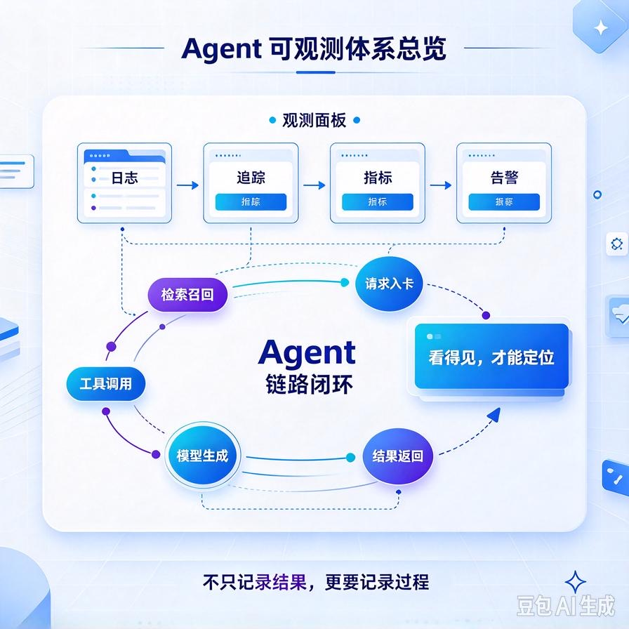
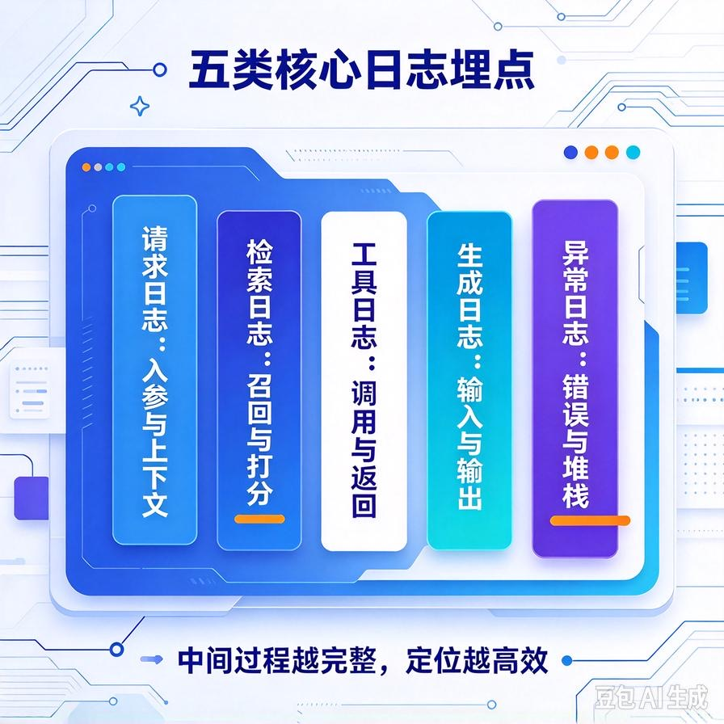
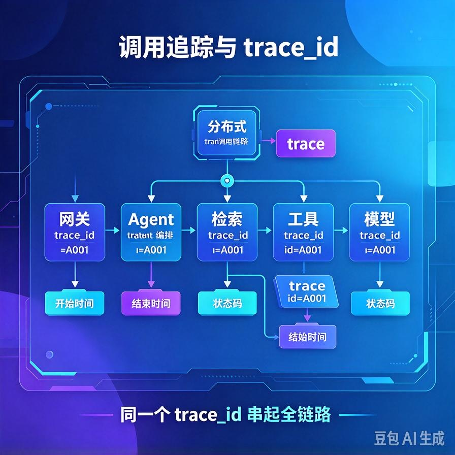
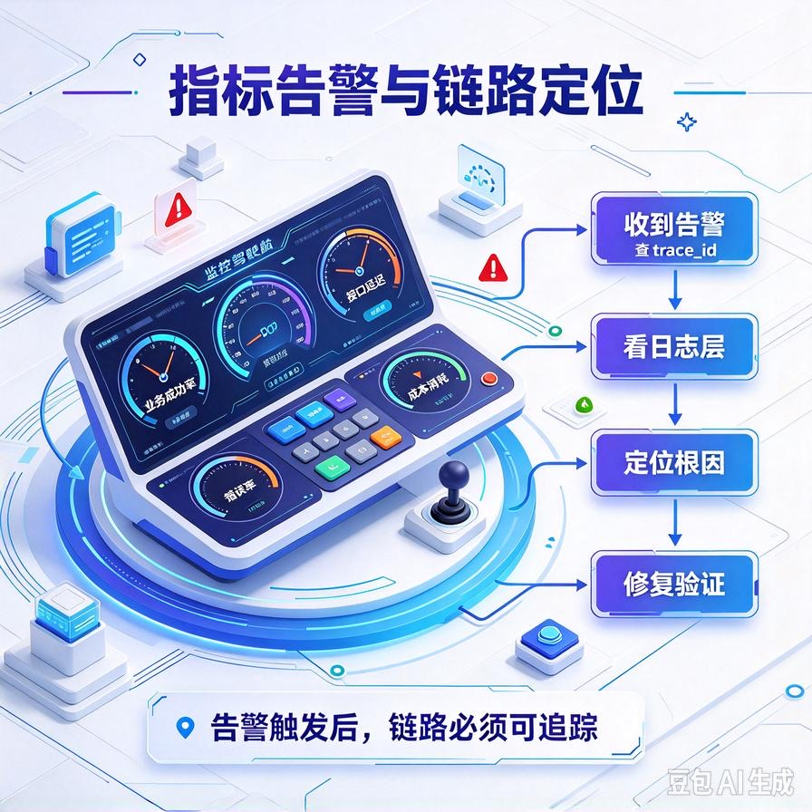

# 第68篇：Agent链路可观测体系 | 日志埋点、调用追踪、指标告警、链路定位

欢迎回到模块四「Agent进阶深挖与面试硬核」。

你有没有遇到过这种情况：客户在群里说"你们的AI今天怎么答得这么离谱"，你一脸懵——它是检索错了？工具调错了？还是模型今天抽风？你翻遍代码也想不起来那次请求到底走了哪一步。等你好不容易定位到，客户已经不耐烦了。

这就是没有可观测体系的下场。第63篇我们提过trace_id，但那只是开头。这一篇要系统讲：**Agent到底该埋哪些日志、trace怎么贯穿整条链路、盯哪些指标、出问题怎么顺着链路五分钟定位**。文末附面试高频问答。



# 一、为什么Agent的可观测比普通服务难

普通Web服务，一次请求就是"接口进→查库→返回"，链路短、行为确定。Agent不一样：

- **链路长**：规划→检索→工具调用→再规划→生成，一环套一环；
- **行为不确定**：同一个问题，这次走工具A下次可能走工具B，每次路径都不一样；
- **黑盒**：大模型内部怎么想的你看不见，只能靠它留下的痕迹反推。

所以Agent的可观测，核心不是"记个访问日志"，而是**把这条不确定的推理链完整地录下来**，出问题能回放、能定位。

# 二、日志埋点：每一步都要留下痕迹



一次Agent请求，至少要埋这几类日志：

| 埋点 | 记录什么 | 为什么重要 |
|-|-|-|
| **请求入口** | 用户query、session_id、tenant_id | 知道是谁、问了什么 |
| **检索日志** | 召回了哪些文档、分数、最终喂了哪几条 | 判断是不是召回错了 |
| **工具调用** | 调了哪个工具、传了什么参数、返回了什么 | 判断是不是工具环节出问题 |
| **生成日志** | 最终Prompt、模型输出、Token消耗、耗时 | 判断是不是生成环节出问题 |
| **异常日志** | 哪一步报错、报错信息、重试了几次 | 定位故障点 |

关键原则：**别只记"成功/失败"，要记中间过程**。客户说答非所问，你得能看到当时召回了哪几段、工具返回了什么，才能判断错在哪。

# 三、调用追踪：一个trace_id贯穿全程



上面这些日志散在各处，怎么串起来？靠**trace_id**。一次请求从进来到结束，全程带同一个trace_id，把规划、检索、工具、生成所有步骤串成一条完整的链路。

```python
import uuid, time

def run_agent(query, session_id, tenant_id):
    trace_id = uuid.uuid4().hex[:12]
    log.info("request_start", trace_id=trace_id,
             tenant_id=tenant_id, session_id=session_id, query=query)

    t0 = time.time()
    docs = retrieve(query)
    log.info("retrieve_done", trace_id=trace_id,
             n_docs=len(docs), ms=int((time.time()-t0)*1000))

    tool_result = call_tool(...)
    log.info("tool_done", trace_id=trace_id, tool="get_order")

    answer = llm_generate(query, docs, tool_result)
    log.info("request_end", trace_id=trace_id,
             tokens=count_tokens(answer))
    return answer
```

客户投诉时，你只要拿到那次对话的trace_id，一搜，整条链路的每一步、每一步耗时和输入输出全出来了。这就是链路定位的基础。

# 四、指标告警：别等客户来报



日志是事后查，指标是事前盯。Agent要盯这几个核心指标：

- **业务指标**：任务完成率、转人工率、用户追问/差评率——直接反映好不好用；
- **性能指标**：平均响应时长、P95延迟、流式首字延迟；
- **稳定性指标**：错误率、工具调用失败率、超时率；
- **成本指标**：每请求平均Token消耗、单租户消耗趋势。

告警要设阈值：错误率突增、P95延迟飙升、某租户Token异常爆量——这些自动告警给你，不用等客户发现。比如某客户一小时Token是平时的10倍，很可能是被刷了或者死循环了，告警一到就能及时止损。

# 五、链路定位：出问题怎么五分钟找到根因

有了上面这些，定位问题就有套路了：

1. 拿trace_id调出整条链路；
2. 看哪一步耗时异常或报错；
3. 是召回阶段？→查召回了哪几段文档，是不是检索策略问题；
4. 是工具阶段？→查工具参数和返回，是不是工具调用错了；
5. 是生成阶段？→查最终Prompt和输出，是不是模型跑偏或幻觉。

这套"分层定位"的思路，和第60篇的评估体系是配套的：评测告诉你"整体好不好"，可观测告诉你"这次具体错在哪"。

# 六、工程踩坑清单

- **只记接口日志，不记中间过程**：出了问题只知道"失败了"，不知道哪一步失败。
- **日志不带trace_id**：各步骤日志散着，串不成一条链，没法回放。
- **记了一堆但没告警**：日志躺在那里没人看，等于没记。关键指标必须配告警。
- **日志泄露敏感数据**：把用户隐私、客户文档原文全打日志里，本身就是安全风险。敏感信息要脱敏。
- **不记耗时分布**：只看平均延迟，P95长尾问题发现不了。

# 📝 面试高频问答

## Q1：Agent系统怎么做可观测？和普通服务有什么不同？

答：普通服务链路短、行为确定，记访问日志就够。Agent链路长（规划→检索→工具→生成）、行为不确定、模型内部是黑盒，所以要把整条推理链完整录下来：每一步的输入输出、耗时、工具调用、Token都埋点，用trace_id串成可回放的链路。核心是能事后回放和定位，而不只是记成功失败。

## Q2：一次Agent请求，你会埋哪些日志？

答：请求入口（query/session/tenant）、检索日志（召回了哪些文档和分数）、工具调用（哪个工具、参数、返回）、生成日志（最终Prompt、模型输出、Token、耗时）、异常日志（哪一步报错、重试几次）。原则是记中间过程，不只记最终结果，这样出问题才能回放。

## Q3：客户反馈"答非所问"，你怎么定位？

答：拿那次对话的trace_id调出整条链路分层排查：看是召回阶段（召回的文档根本不对）、工具阶段（工具调错或返回错）、还是生成阶段（Prompt或模型跑偏）。每一环的输入输出都有日志，逐层缩小范围，不用猜。

## Q4：Agent要监控哪些核心指标？

答：四类。业务指标（任务完成率、转人工率、差评率）反映好不好用；性能指标（响应时长、P95延迟、首字延迟）；稳定性指标（错误率、工具失败率、超时率）；成本指标（每请求Token、单租户消耗趋势）。关键指标设阈值告警，比如错误率突增、某租户Token异常爆量。

## Q5：日志里直接存用户隐私和客户文档原文有什么风险？

答：日志本身成了新的数据泄露点。用户隐私、客户保密文档如果明文落盘，一旦日志库被访问或导出就出事。敏感信息要脱敏后再记日志，真正的原文按需存、严格权限管控。可观测不能以牺牲安全为代价。

---

下一篇讲省钱和保命的平衡术：**第69篇｜模型路由与降级策略**——怎么按任务复杂度自动选大模型/小模型，主模型挂了怎么自动切到备用模型。

> 来源：头条号《AI Agent 零基础实战》第68篇｜版权归作者所有，仅供学习交流
