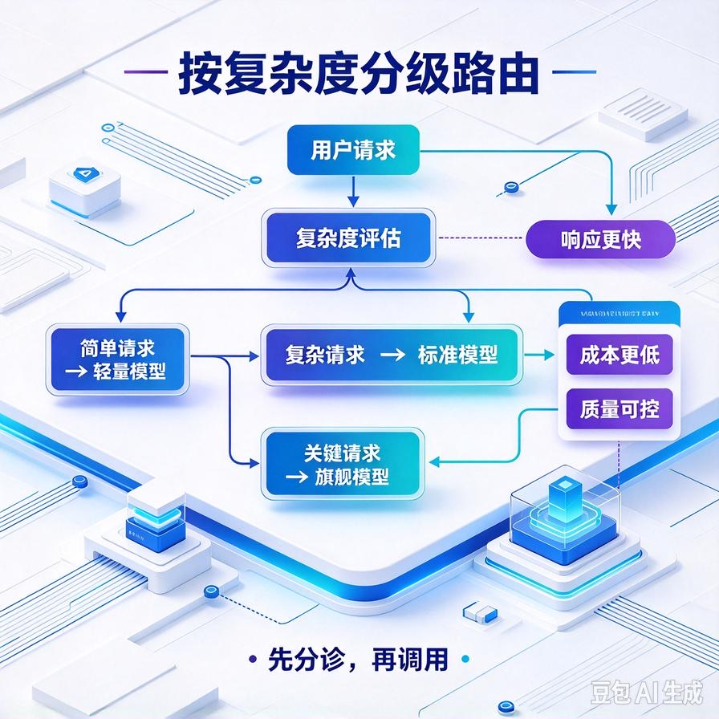
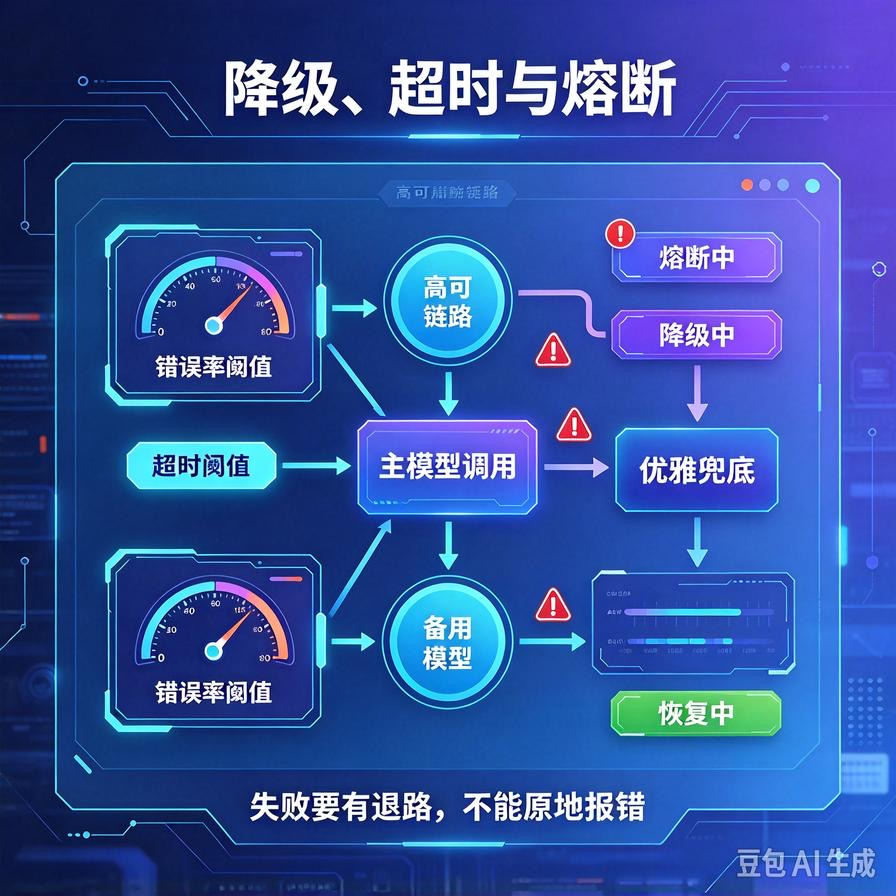
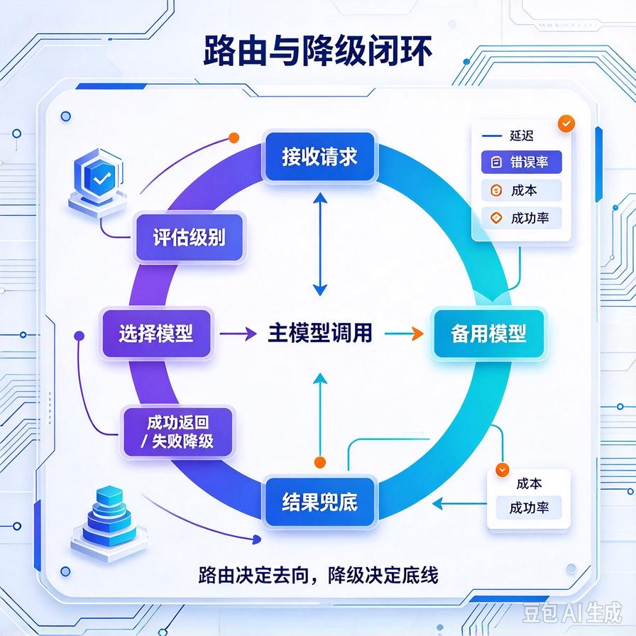

# 第69篇：模型路由与降级策略 | 多模型智能分发、超时熔断、主备自动切换

欢迎回到模块四「Agent进阶深挖与面试硬核」。

做商用Agent，你迟早会遇到一个两难：**全用旗舰大模型，效果好但成本扛不住；全用便宜小模型，成本下来了但客户嫌效果差**。更头疼的是，主力模型哪天接口限流、抽风、甚至停服，你的整个服务直接挂掉。

解法就是这一篇要讲的两件事：**模型路由（按任务智能选模型，省钱又保效果）+ 降级策略（主模型出问题自动切备用，保命不挂服务）**。这是商用系统降本增效和高可用的核心。文末附面试高频问答。


# 一、先算账：一个模型打天下为什么不划算

想象你的客服Agent，每天1000个请求。其中80%是简单问题——"发货了吗""退货地址是哪"，这类问题小模型完全能答好；只有20%是复杂的多步推理。但如果你全部用旗舰模型，等于为那80%的简单问题付了旗舰的钱。

粗算一笔账：假设旗舰模型成本是小模型的5倍。全用旗舰，每月成本X；80%路由给小模型，成本大约变成 `0.8×(X/5) + 0.2×X = 0.36X`——**直接省掉6成以上**，效果还基本不受影响。这就是模型路由的价值。

# 二、模型路由：把任务分给合适的模型



核心思路：**用一个极便宜的小模型当"分诊台"，先判断这个问题的复杂度，再决定派给哪个模型**。

```python
ROUTER_PROMPT = """判断下面这个用户问题的复杂度，只输出一个词：
- simple: 查订单、问政策、简单事实问答
- complex: 需要多步推理、综合多个文档、写长文、分析
问题：{query}"""

def route_model(query):
    level = cheap_llm(ROUTER_PROMPT.format(query=query))  # 极便宜模型分诊
    if level.strip() == "complex":
        return PREMIUM_MODEL      # 复杂问题用旗舰
    return FAST_MODEL             # 简单问题用便宜快速模型

def answer(query):
    model = route_model(query)
    return call_model(model, query)
```

路由的几个实操要点：

- **分诊本身也要省钱**：判断复杂度这一步用最便宜最快的模型，别为了路由反而花更多钱；
- **分层要清晰**：通常分两到三档足够（快/中/旗舰），别搞太细；
- **可人工调整**：给路由留个开关，某些客户/某些问题强制走旗舰，便于兜底。

# 三、降级策略：主模型挂了自动切备用



光省钱不够，还得保命。你的服务不能因为某一个模型供应商挂了就整个瘫痪。这就是降级。

## 1. 主备自动切换

给每个"档位"准备至少两个模型供应商。主模型超时、报错、限流时，自动切到备用模型：

```python
MODELS = {
    "premium": [{"name": "gpt-4o"}, {"name": "claude"}, {"name": "qwen-max"}],
    "fast":    [{"name": "gpt-4o-mini"}, {"name": "qwen-turbo"}],
}

def call_with_failover(query, level):
    for m in MODELS[level]:          # 按顺序尝试
        try:
            return call_model(m["name"], query, timeout=15)
        except (TimeoutError, RateLimitError, ServerError):
            log.warning(f"{m['name']} 失败，切换下一个")
            continue
    raise AllModelDown("所有模型都不可用")   # 兜底：返回友好话术
```

## 2. 超时与熔断

不能傻等。每个模型调用设超时（比如15秒），超时就判定这个模型此刻不可用。更进一步，如果某个模型连续失败好几次，就**熔断**它一段时间（比如30秒内不再尝试），直接走备用——免得每次请求都先在坏模型上浪费15秒。

## 3. 优雅兜底

所有模型都挂了怎么办？不能让用户看到一片空白。返回友好提示："当前服务繁忙，请稍后再试"，同时把这个问题落进队列，等模型恢复了再处理，或者直接转人工。

# 四、路由和降级怎么配合



把两件事合起来看：**路由决定"该用哪个档位"，降级决定"这个档位挂了用谁顶"**。一个完整的请求流程是：

1. 便宜小模型分诊，判断走fast档还是premium档；
2. 按档位选主模型；
3. 主模型超时/报错，熔断并自动切同档备用模型；
4. 整档都不可用，降级到更低档（复杂问题实在不行也用次优模型答）或兜底话术。

这样既省了钱（简单问题不花旗舰的钱），又保了命（单点模型挂了不影响整体服务）。

# 五、工程踩坑清单

- **路由本身太贵**：用旗舰模型去判断"这个问题要不要用旗舰"，逻辑就反了。分诊必须用最便宜的模型。
- **不设超时就重试**：每个请求都在坏模型上干等30秒，整体延迟崩盘。必须设超时。
- **没有熔断**：一个模型挂了，每个请求都先试它一次再切备用，平白无故多一倍延迟。要熔断坏模型。
- **降级后效果断崖**：备用模型能力差太多，切过去用户明显感觉答变差。备用模型要选能力接近的。
- **不记录路由和切换日志**：出问题不知道是路由错了还是降级了，没法复盘。每次走了哪个模型、有没有切换，都要记。

# 📝 面试高频问答

## Q1：什么是模型路由？为什么需要它？

答：用便宜小模型先判断任务复杂度，简单问题走快速小模型、复杂问题走旗舰大模型，而不是所有请求都用最贵的模型。因为大部分请求其实很简单，全用旗舰模型成本浪费严重。路由能在几乎不损失效果的前提下，把整体Token成本降一大截。

## Q2：主模型挂了，线上服务怎么不崩？

答：做主备降级。每个档位准备多个模型供应商，主模型超时、报错、限流时自动切到同档备用模型；设超时防止干等，连续失败就熔断该模型一段时间不再试；整档都不可用时优雅兜底——返回友好提示、落队列稍后处理或转人工。核心是任何单点故障都不导致整体服务不可用。

## Q3：路由和降级是什么关系？

答：路由决定"这个任务该用哪个档位的模型"（省钱），降级决定"这个档位的主模型挂了用谁顶"（保命）。完整流程：小模型分诊定级→选该档主模型→主模型失败熔断并切同档备用→整档不可用再降级或兜底。两者配合，既控成本又保高可用。

## Q4：为什么模型调用一定要设超时和熔断？

答：不设超时，一个慢模型会让请求一直挂着，拖垮并发和延迟。熔断则是为了避免重复在已知坏的模型上浪费时间——一个模型连续失败后，短时间内直接跳过它走备用，而不是每个请求都先等它超时。这是防止级联故障的关键。

## Q5：怎么做才不会让降级后的效果断崖式下跌？

答：备用模型要选能力接近的同档产品，而不是从旗舰直接掉到玩具模型；复杂问题降级时宁可返回"稍后处理/转人工"，也不要让一个明显不行的模型硬答出错误答案。同时记录每次路由和切换，监控降级发生的频率和对效果的影响，持续调整备用模型组合。

---

下一篇讲长任务怎么扛：**第70篇｜Agent异步任务队列实战**——超过30秒的复杂任务怎么后台排队、怎么推进度、怎么处理超时和清理。

> 来源：头条号《AI Agent 零基础实战》第69篇｜版权归作者所有，仅供学习交流
