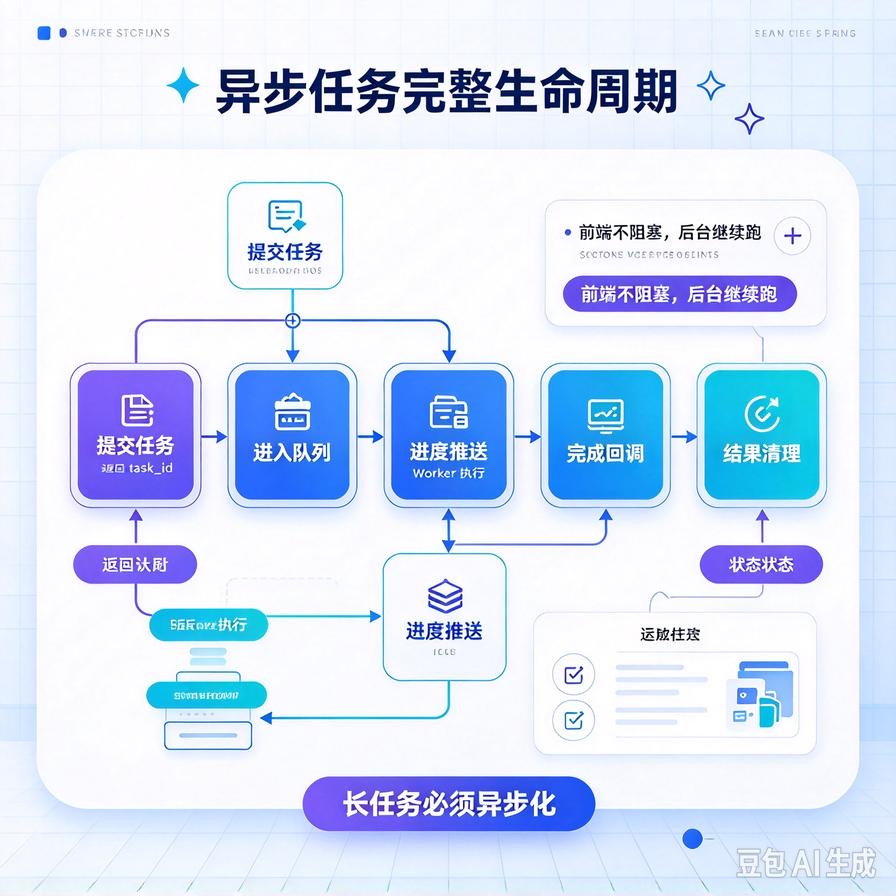
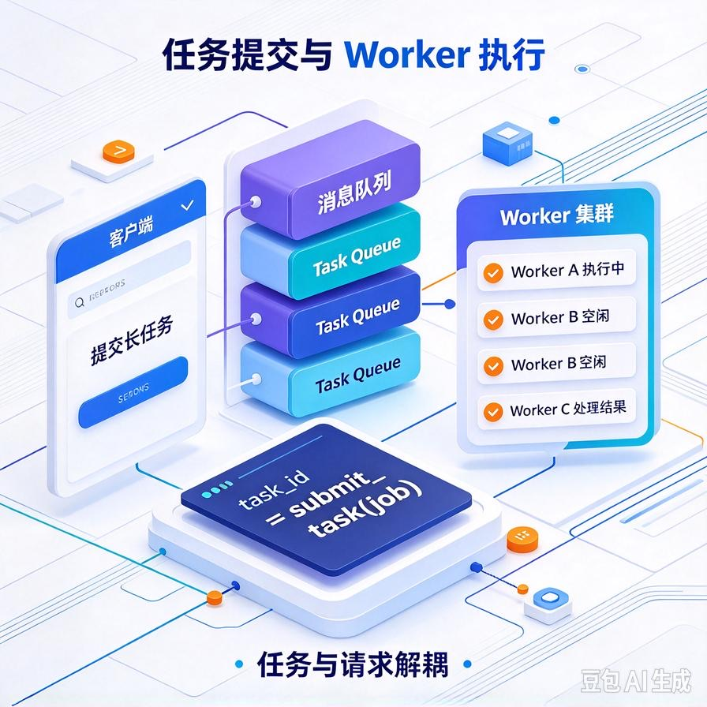
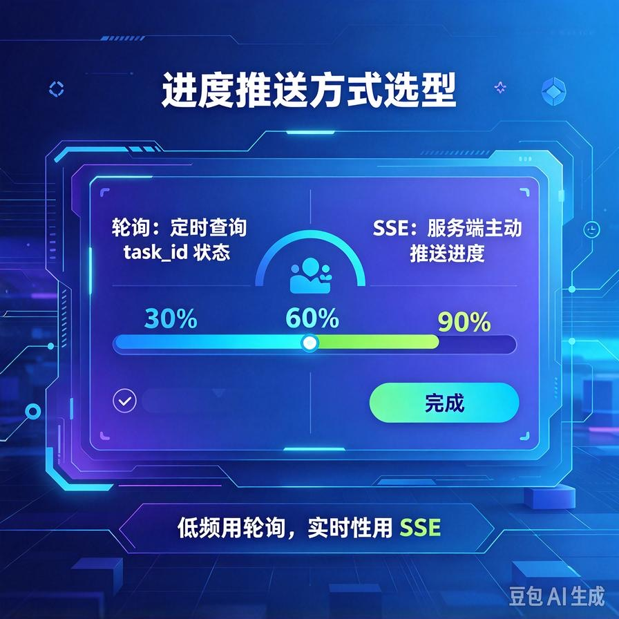
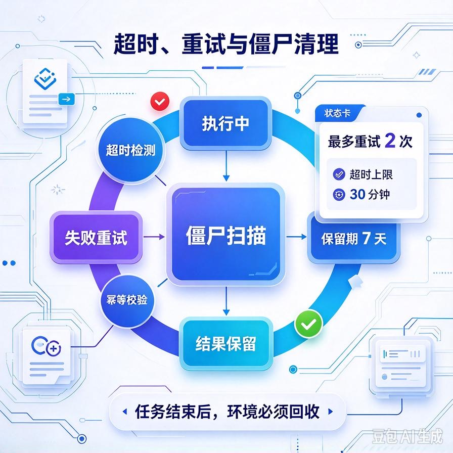

# 第70篇：Agent异步任务队列实战 | 长耗时任务、后台排队、进度回调、任务超时清理

欢迎回到模块四「Agent进阶深挖与面试硬核」。

想象一个场景：客户让你的Agent"把这500页合同全部入库并生成问答库"，或者"写一份30页的行业分析报告"。这种任务跑下来要几分钟甚至十几分钟。如果你用普通的同步接口——一个HTTP请求挂在那里等十几分钟，早超时了、连接断了、用户还以为系统死了。

解法就是异步任务队列：**长任务不要当场做完，而是提交进后台排队，立刻返回一个任务号，后台慢慢跑，跑完或推进度了再通知前端**。这一篇专讲这套机制怎么落地。文末附面试高频问答。

# 一、为什么长任务不能同步等

同步等待的问题一串：

- **HTTP超时**：网关、代理默认几十秒就断连接，你后台还在跑，前端已经收不到结果；
- **占着worker**：一个请求占着进程十几分钟，并发稍高服务就堵死；
- **用户体验差**：用户对着转圈页面十几分钟，早关了。

异步化的本质：**把"立即要结果"和"需要很久"两件事拆开**。接口立刻受理，任务后台慢慢跑。

# 二、异步任务的完整流程



```text
用户提交任务
  → 接口立刻返回 task_id（不阻塞）
  → 任务进入队列排队
  → 后台worker取出执行，分阶段更新进度
  → 前端轮询 / SSE接收进度
  → 任务完成，前端拿到结果
  → 失败/超时则标记并清理
```

# 三、提交任务与返回task_id



用户一提交，不执行，只往队列里丢个任务，马上返回任务号：

```python
@app.post("/longtask")
def submit_longtask(query: str, tenant_id: str):
    task_id = uuid.uuid4().hex[:12]
    # 任务入队，并初始化状态
    task_queue.enqueue({
        "task_id": task_id,
        "tenant_id": tenant_id,
        "query": query,
        "status": "QUEUED",
        "progress": 0
    })
    return {"task_id": task_id}   # 立刻返回，不等执行
```

注意：**这里的状态管理直接复用第64篇的状态机**——任务状态（排队/执行中/完成/失败）持久化在Redis/DB，这就是它和异步队列的结合点。

# 四、后台执行与进度更新

后台worker从队列取任务，边执行边更新进度：

```python
def run_worker():
    while True:
        task = task_queue.dequeue()
        update_status(task["task_id"], "RUNNING", progress=10)
        try:
            for step in run_long_agent(task):   # 长任务分阶段
                update_status(task["task_id"],
                              progress=step.progress)
            update_status(task["task_id"], "DONE",
                          result=step.result)
        except Exception as e:
            update_status(task["task_id"], "FAILED", error=str(e))
```

# 五、进度怎么推给前端



两种方式，按场景选：

| 方式 | 做法 | 适用 |
|-|-|-|
| **轮询** | 前端每隔几秒查一次任务状态接口 | 实现简单、进度更新不频繁 |
| **SSE推送** | 建一条SSE连接，进度变了就推 | 要实时进度条、体验好 |

第62篇讲过的流式SSE，这里可以直接复用。简单场景轮询就够了，别过度设计。

# 六、任务超时与僵尸清理



异步任务最怕两件事：worker崩了任务卡在中间、任务跑飞了一直不结束。必须兜底：

- **超时上限**：每个任务设最长执行时间（比如10分钟），到点强制失败；
- **失败重试**：worker处理中崩溃，任务重新入队，但要防重复执行（靠幂等，见第61篇）；
- **僵尸清理**：定时扫描卡在RUNNING超过阈值的任务，标记失败并重试或丢弃；
- **结果保留期**：任务结果存一段时间后清理，别一直占存储。

# 七、工程踩坑清单

- **长任务还走同步接口**：必超时、必堵死worker。该异步就异步。
- **任务状态不落盘**：worker一重启，正在跑的任务全丢。状态要持久化。
- **不设超时**：任务跑飞了无限占用worker。
- **重试不幂等**：worker崩溃重跑，导致重复入库、重复生成。写操作必须幂等。
- **结果不清理**：任务结果无限堆积，存储被吃满。
- **前端干等**：不推进度，用户不知道在跑还是死了。要有进度反馈。

# 📝 面试高频问答

## Q1：为什么长耗时任务要异步化？同步接口不行吗？

答：同步等不下去。HTTP网关几十秒就超时断连，长任务要跑几分钟根本等不到；而且一个请求占着worker十几分钟，并发一高服务就堵死；用户对着转圈页面体验也差。异步化是把"受理"和"执行"拆开——接口立刻返回task_id，后台排队慢慢跑。

## Q2：异步任务的完整流程是怎样的？

答：用户提交→接口立刻返回task_id→任务入队→后台worker取出执行、分阶段更新进度→前端轮询或SSE收进度→完成后取结果→失败或超时则标记清理。任务状态要持久化（复用状态机），这样worker重启也能恢复。

## Q3：进度怎么通知前端？轮询和SSE怎么选？

答：进度更新不频繁、图简单就用轮询，前端每隔几秒查一次状态接口；要实时进度条、体验要求高就用SSE推送，进度一变就推给前端。简单场景轮询足够，不必为了实时性硬上SSE。

## Q4：worker处理中途崩了，任务怎么办？

答：任务状态是持久化的，worker重启后可以从队列重新取出继续执行。但写操作必须幂等——重跑不能导致重复入库或重复生成。同时要设任务超时上限，跑飞了的任务强制失败，别让它一直占worker。

## Q5：怎么防止异步任务把系统拖垮？

答：三道兜底。每个任务设最长执行时间超时；定时扫描卡在RUNNING超过阈值的僵尸任务，标记失败重试或丢弃；任务结果保留一段时间后清理，不无限占存储。配合队列本身的并发和长度控制，防止任务堆积。

---

下一篇往底层走：**第71篇｜向量库选型与性能调优**——不同向量库怎么选、文档量大了召回变慢怎么优化、过滤查询和索引怎么调。

> 来源：头条号《AI Agent 零基础实战》第70篇｜版权归作者所有，仅供学习交流
