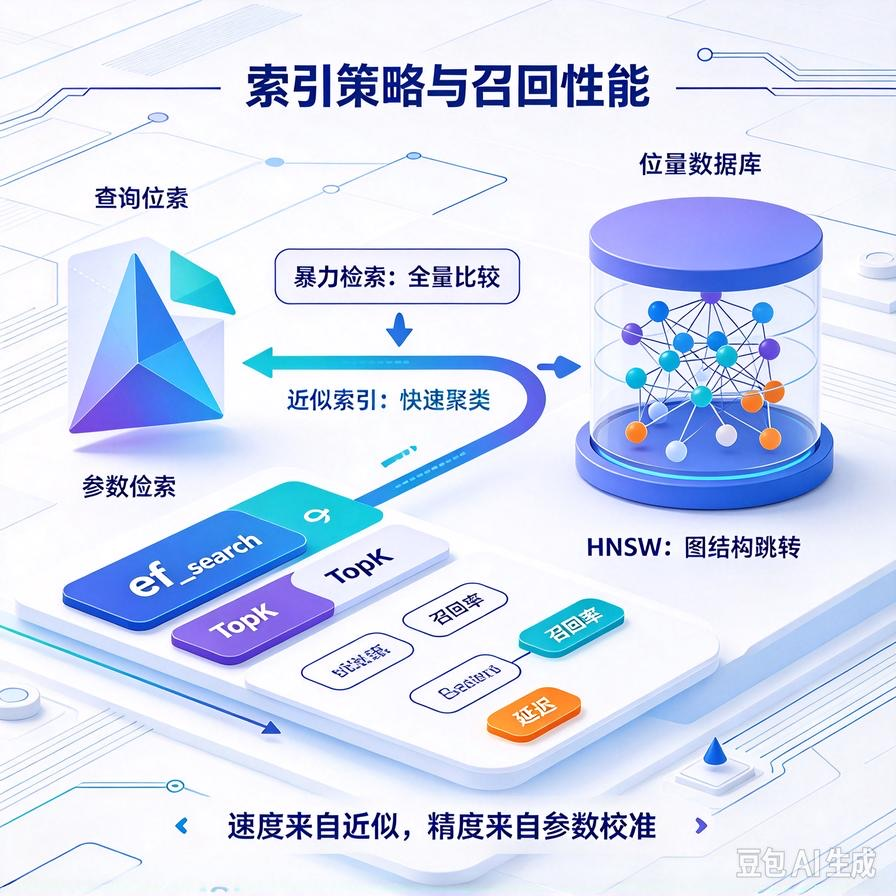
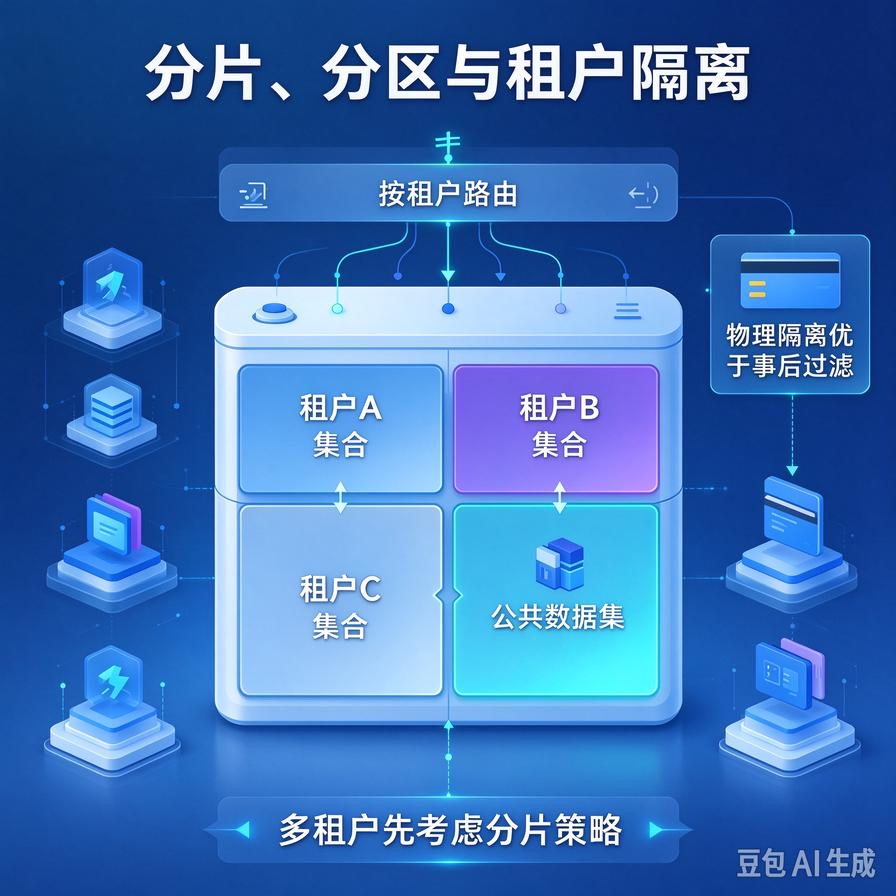

# 第71篇：向量库选型与性能调优 | 索引策略、分片、过滤查询、召回瓶颈排查

欢迎回到模块四「Agent进阶深挖与面试硬核」。

第13篇我们用ChromaDB几十行代码把向量库存起来了，跑Demo飞快。但客户一上来就是几十万、上百万条切片，问题马上来了：**召回一次要几秒、带个租户过滤更慢、文档多了召回还变不准**。这时候你就从"会用向量库"变成"得懂怎么调它"。

这一篇专讲：**向量库怎么选、索引策略的代价是什么、分片怎么拆、带元数据过滤的坑、以及召回变慢怎么定位瓶颈**。文末附面试高频问答。

# 一、向量库选型：别一上来就上重型武器

新手最容易在选型上走极端：要么一直用Demo级的Chroma撑到生产，要么一上来就折腾Milvus集群。正确做法是按数据规模选。

| 规模 | 选什么 | 说明 |
|-|-|-|
| **十万条以内** | Chroma / FAISS本地版 | 简单、快、零运维，接单Demo和小客户足够 |
| **几十万\~百万** | Qdrant / Weaviate（单机） | 支持过滤、持久化、性能好，运维适中 |
| **百万以上/高并发** | Milvus集群 | 分布式、可扩展，但运维成本高 |

接单实战的经验：**小客户用Chroma/FAISS快速交付，中大型客户上Qdrant单机，真到了百万级高并发再考虑Milvus**。别为了"听起来专业"过度设计。

# 二、索引策略：召回率和速度的tradeoff

向量检索慢，根源是"要在百万向量里找最相似的几个"。索引就是为加速而生，但所有近似索引都在**用一点点召回率换巨大的速度**。

## 1. 暴力检索 vs 近似索引

- **暴力检索（Flat）**：逐条算相似度，最准但最慢，数据量大了不可用；
- **近似索引（HNSW等）**：建图结构，只搜附近几个邻居，快几个数量级，但理论上可能漏掉个别真正最相似的。

## 2. HNSW的关键参数

HNSW是现在主流近似索引，两个核心参数要懂：

- **ef_search**：检索时探索多少个候选。调大→更准更慢，调小→更快但可能漏。
- **TopK**：最终返回几条。第56篇讲过，不是越大越好。

工程上就是在这两个参数上找平衡：**先用默认值跑评测集，再根据召回率指标微调**，别凭感觉拍。

# 三、分片：数据多了怎么拆

数据到了百万级，单集合扛不住，要分片。但接单场景里，**多租户本身就是天然的分片依据**：

- 按租户分集合——每个客户一个独立collection，隔离干净（呼应第67篇多租户）；
- 或者单集合内按tenant_id过滤——数据量小这么做最省运维；
- 超大规模再按租户哈希到多个物理分片，水平扩展。

关键认知：**不要把所有客户、所有文档塞进一个巨大的集合**，既不好隔离，性能也上不去。

# 四、过滤查询：带元数据过滤的坑

第67篇讲了检索必须带tenant_id过滤。但这里有个性能坑：**在近似索引上叠加过滤，会让加速失效**。

原因是：HNSW图是为"找最相似"优化的，你硬加一个"且tenant_id=A"的条件，它可能得先按图搜、再过滤，把被租户排除的向量算进去又扔掉，反而变慢。

解法：

- **租户隔离优先用物理分集合**，而不是在大集合里过滤——过滤完不用过滤，最快；
- 必须在单集合过滤时，选**支持"过滤优先"的向量库**（如Qdrant、Milvus都优化了带过滤检索）；
- 高频过滤字段（tenant_id、文档类型）建索引，别每次全表扫。

# 五、召回变慢怎么排查瓶颈

线上召回突然变慢，按这个顺序查：

1. **是数据量涨了还是流量涨了**：先看是不是数据规模到了该换索引/分片的时候；
2. **看是召回慢还是生成慢**：用第68篇的trace日志拆开，别把生成慢当成检索慢；
3. **看过滤条件**：是不是加了没建索引的过滤字段，导致全扫；
4. **看索引参数**：ef_search是不是调太大、TopK是不是设太多；
5. **看内存**：向量库很吃内存，向量是否都在内存里，还是被挤到磁盘了。

# 六、工程踩坑清单

- **Demo库硬扛生产**：Chroma跑到几十万条就该考虑升级，别等到线上卡死。
- **盲目上重型集群**：小客户上Milvus，运维成本比省下的钱还多。
- **近似索引不调参数**：默认参数不一定适合你的数据，要拿评测集调。
- **大集合里硬过滤**：近似索引上叠加元数据过滤会拖慢，多租户优先物理分集合。
- **不监控内存**：向量库吃内存大户，向量被挤到磁盘后召回断崖式变慢。
- **把生成慢当检索慢**：先靠trace日志拆环节，别瞎调向量库。

# 📝 面试高频问答

## Q1：向量库怎么选型？

答：按规模来。十万条以内用Chroma/FAISS本地版，简单零运维；几十万到百万用Qdrant/Weaviate单机，支持过滤和持久化；百万以上高并发才上Milvus集群。接单时小客户快速交付用轻量库，大客户再升级，别一上来就上重型集群徒增运维。

## Q2：为什么向量检索要用近似索引？牺牲了什么？

答：暴力检索逐条算相似度最准但数据量大了太慢。近似索引（如HNSW）通过图结构只搜附近候选，快几个数量级，代价是理论上可能漏掉个别真正最相似的——用一点点召回率换巨大速度。工程上用ef_search等参数在召回率和速度间找平衡。

## Q3：多租户在向量库里怎么隔离比较好？

答：优先物理隔离——每个租户独立collection，既隔离干净，又避免在大集合里做过滤拖慢检索。数据量小也可以单集合按tenant_id过滤，但要选支持过滤优化的向量库，并给过滤字段建索引。不要所有客户塞一个大集合。

## Q4：在向量库里加元数据过滤，为什么会变慢？

答：近似索引是为"找最相似"优化的，叠加"且tenant_id=某值"这类条件后，引擎可能先按图搜一批、再把被排除的向量算进去又扔掉，加速效果被抵消。解法是多租户优先物理分集合，必须单集合过滤时选优化了带过滤检索的库，并给高频过滤字段建索引。

## Q5：线上召回突然变慢，怎么排查？

答：先看数据量和流量是不是涨了，到没到该换索引/分片的规模；用trace日志拆开，确认是检索慢还是生成慢，别张冠李戴；再看是不是加了没建索引的过滤条件、索引参数调得太大、或者向量库内存不足把向量挤到了磁盘。逐层缩小范围。

---

下一篇是模块四的收官：**第72篇｜Agent成本精细化监控**——怎么按用户、按任务、按工具细分统计Token，异常消耗怎么拦截，把接单项目的利润真正攥在手里。

> 来源：头条号《AI Agent 零基础实战》第71篇｜版权归作者所有，仅供学习交流
