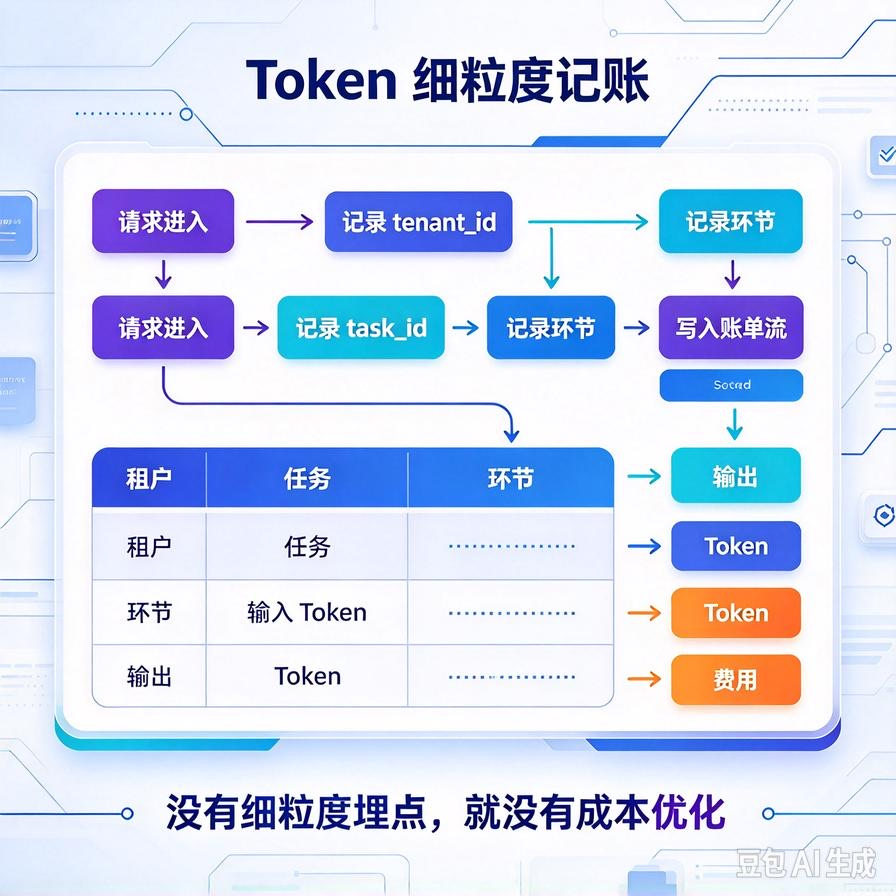
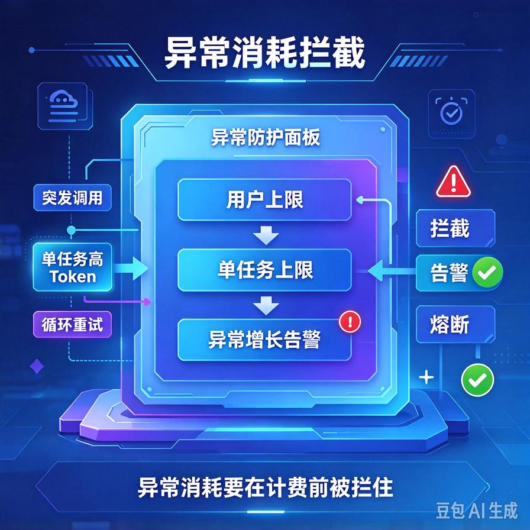
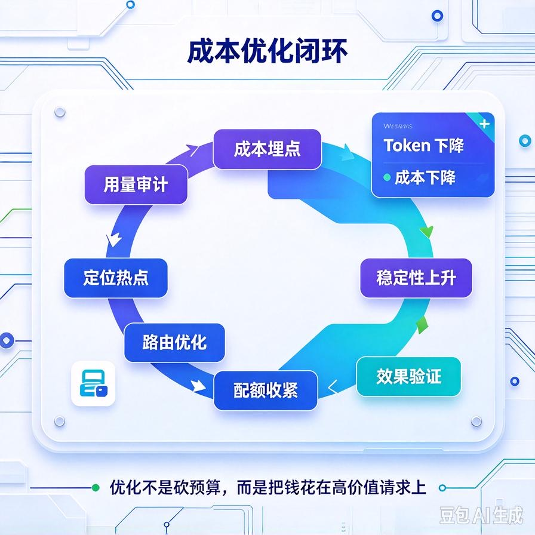

# 第72篇：Agent成本精细化监控 | Token细粒度统计、用户用量审计、异常消耗拦截

欢迎回到模块四「Agent进阶深挖与面试硬核」，这也是本模块的收官篇。

接单的同学最容易忽略一笔账：你收了客户一年2万服务费，年底一算，API账单花了1万5——忙一年给大模型厂商打工。更隐蔽的是，某个用户陷入死循环，一晚上烧了你几百块Token你都不知道。

第45篇我们讲过宏观的成本节流，这一篇往细里走：**怎么把Token成本拆到每个用户、每个任务、每个工具，怎么审计用量，怎么在异常爆量时及时拦截**。把利润真正攥在手里。文末附面试高频问答。


# 一、粗账不算，细账才见利润

大多数人只看"这个月API总账单"，这是糊涂账。你得能回答这些问题：

- 哪个客户最烧钱？哪个客户其实在亏钱？
- 钱花在哪了——是检索、是工具调用、还是生成？
- 今天有没有哪个用户消耗突然是平时的10倍？

答不上来，说明你的成本监控是缺失的。精细化成本监控，就是把每一分Token都拆到可归因的颗粒度。

# 二、Token细粒度统计：钱花在哪，一目了然



核心动作：**每次模型调用都记下这次的输入Token、输出Token、用的哪个模型、属于哪个租户哪个任务**，落库汇总。

```python
def call_model(model, messages, tenant_id, task_id, step):
    resp = client.chat.completions.create(model=model, messages=messages)
    usage = resp.usage
    # 按 租户+任务+环节 维度记账
    redis.hincrby(f"cost:{tenant_id}:{month()}", "tokens_in", usage.prompt_tokens)
    redis.hincrby(f"cost:{tenant_id}:{month()}", "tokens_out", usage.completion_tokens)
    log.info("token_usage",
             tenant_id=tenant_id, task_id=task_id, step=step,
             model=model, in=usage.prompt_tokens, out=usage.completion_tokens)
    return resp.choices[0].message.content
```

这样记账，你就能出各种报表：按租户对比、按环节拆（检索增强占多少、生成占多少）、按模型拆（路由给小模型后省了多少）。第69篇做的模型路由省了多少钱，这里能量化出来。

# 三、用户用量审计：账单和配额的基础

细粒度统计的数据，直接支撑两件事：

- **出账单**：每个租户每月用了多少Token、多少次工具调用，按套餐定价——这是SaaS收费的依据（呼应第67篇）；
- **配额限流**：用量到了套餐上限就限流或提示升级，防止无限用。

有了这套数据，你才知道该给客户定什么价：一个月烧50块API成本的项目，收2万是暴利；烧80块的，定价就得往上调。

# 四、异常消耗拦截：别让一次死循环烧掉一天利润



成本监控最重要的实战价值，是**及时发现并拦住异常消耗**。常见的异常：

- **死循环**：Agent反复调用，一个任务跑了几十轮，Token爆涨（第61、64篇的步数/超时限制就是防这个）；
- **被刷量**：恶意用户或爬虫疯狂调用，把你的API额度打光；
- **配置错误**：某段Prompt写错，把超长上下文塞进去，每次请求成本翻10倍。

拦截手段：

- **按用户设日/小时Token上限**：超过就限流，从源头封顶；
- **异常增长告警**：某租户/某时段消耗突增（比如环比涨5倍）立刻告警；
- **单任务Token上限**：一个任务最多烧多少Token，到了强制停——这是死循环的最后一道闸门。

# 五、成本优化的闭环



精细化监控不是为了记账而记账，它形成一个闭环：

1. 埋点统计，看清钱花在哪；
2. 发现某个环节特别烧钱（比如检索喂了太多文档）；
3. 针对性优化（第56篇的TopK调小、第69篇的模型路由、第19篇的Token压缩）；
4. 再看监控数据，验证省了多少。

没有监控，优化就是凭感觉；有了它，每一分节流都能量化。

# 六、工程踩坑清单

- **只看月度总账单**：不知道钱花在哪个客户、哪个环节，利润是笔糊涂账。
- **不按租户/任务细分**：出不了账单，也算不出单客户利润。
- **不设单用户/单任务Token上限**：死循环或被刷量一次，烧掉好几天利润。
- **没有异常告警**：等月底对账才发现被刷了，钱已经没了。
- **优化后不验证**：改了Prompt/路由，不知道到底省没省，全靠感觉。

# 📝 面试高频问答

## Q1：怎么精细化统计Agent的成本？

答：每次模型调用都记录输入Token、输出Token、所用模型，并打上租户、任务ID、执行环节的标签，落库后按维度汇总。这样能拆出哪个客户最烧钱、钱花在检索还是生成、模型路由省了多少。核心是把成本从"月度总账单"拆到可归因的颗粒度。

## Q2：怎么防止Agent异常消耗把利润烧掉？

答：三道拦截。按用户设日/小时Token上限，超了限流；单任务设Token上限，到点强制停，这是死循环的最后闸门；监控异常增长，某租户消耗环比暴涨立刻告警。配合第61篇的步数限制、第69篇的模型路由，从源头把异常消耗按住。

## Q3：成本监控和SaaS计费是什么关系？

答：细粒度Token统计是计费的基础。按租户汇总每月用量（Token、工具调用次数），就是出账单和定套餐的依据；用量到了上限就限流或提示升级。有了真实成本数据，才能合理定价——知道每个客户的API成本，才知道该收多少钱、有没有利润。

## Q4：发现某个环节特别烧Token，你怎么优化？

答：靠监控定位到具体环节后针对性优化。如果是检索喂太多文档，就调小TopK、做上下文压缩；如果是简单问题也在用旗舰模型，就上模型路由分流给小模型；如果是Prompt太冗长，就做Token压缩。优化后再用监控数据验证到底省了多少，形成闭环。

## Q5：为什么要给单个任务设Token上限？

答：因为Agent可能陷入死循环或反复重试，一个任务如果不设上限，能跑几十轮烧掉远超预期的Token。单任务Token上限是最后一道闸门——宁可任务失败兜底，也不能让它无限烧钱。它和最大步数、执行超时一起，构成Agent的成本熔断。

---

到这里，模块四「Agent进阶深挖与面试硬核」（64\~72）就完整收官了。从状态机、结构化输出、安全攻防、多租户、可观测、模型路由、异步队列、向量库调优，一路讲到成本监控——这套东西既是商用Agent的工程必修课，也是AI应用岗面试的硬核加分项。

后续可按需续更备选篇目（73灰度发布、74幻觉根治、75端侧轻量化）。你已经把一套"从技术筑基→接单变现→高阶工程→面试硬核"的完整体系跑通了，接下来无论是接单、做产品还是求职，都有了扎实的底牌。

> 来源：头条号《AI Agent 零基础实战》第72篇｜版权归作者所有，仅供学习交流
