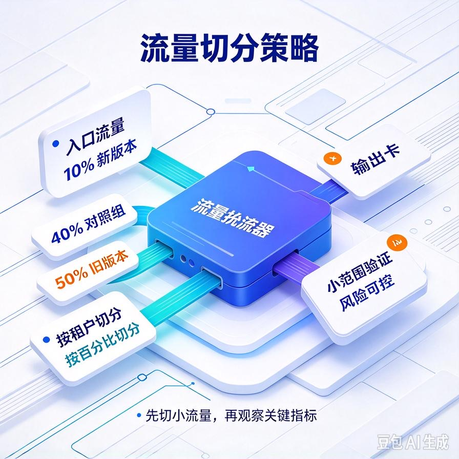
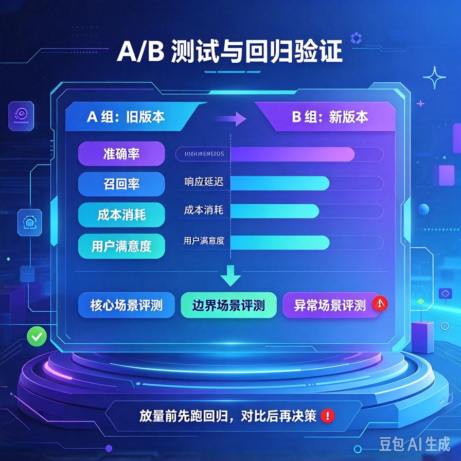
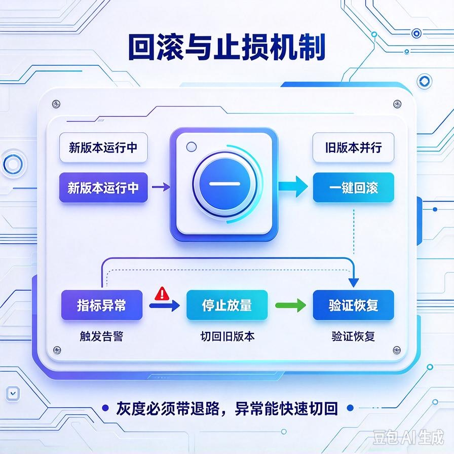

# 第73篇：Agent版本灰度发布 | 策略A/B测试、流量切分、回归验证

欢迎来到备选续更篇。

做Agent的人都有过这种惊魂时刻：你把Prompt调优了、换了个效果更好的模型，测试集上数据涨了一截，高高兴兴全量上线——结果第二天客户群炸了："怎么现在答得还没之前好？"原来你优化A场景的同时，把B场景悄悄改坏了。

这就是没有灰度发布的代价。第63篇我们提过灰度的概念，这一篇专门讲透：**新版本怎么按租户/流量切分、新旧版本怎么A/B对比、上线前怎么做回归验证、出问题怎么一键回滚**。文末附面试高频问答。


# 一、为什么不能改完直接全量

Agent和传统软件不一样，它的效果是"概率性"的：你改Prompt或换模型，测试集上变好，不代表线上每个真实问题都变好。**它没有确定性的编译产物，一次改动影响的是一整片概率分布**。

所以"改完直接全量"是高风险动作。正确做法是：**先小范围放，用真实流量验证，确认不退化再逐步放大**。这就是灰度。

# 二、灰度怎么切：按租户、按流量



两种常见切法：

| 方式 | 怎么做 | 适用 |
|-|-|-|
| **按租户切** | 新版本先给指定客户/测试用户用，其他人照旧版本 | SaaS多租户，最稳妥 |
| **按流量百分比** | 10%请求走新版，90%走旧版，逐步放大 | 大流量、需统计显著性 |

接单实战里最常用的是按租户切：**先放给你自己和1\~2个配合度高的老客户观察几天，没问题再推给其他客户**。多租户架构（第67篇）天然支持这个——按租户路由到不同版本就行。

```python
NEW_VERSION_TENANTS = {"test_customer", "internal"}

def route_version(tenant_id, query):
    if tenant_id in NEW_VERSION_TENANTS:
        return run_v2(query)   # 灰度用户走新版
    return run_v1(query)       # 其他人走稳定旧版
```

# 三、A/B测试：用数据说话，不靠感觉



灰度期间，新旧版本同时在线，你要做的是**对比关键指标**，而不是凭感觉说"好像新版更好"。

对比什么指标？就是第60篇评估体系里那几个：任务完成率、错误率、转人工率、平均Token成本、P95延迟。新版必须在这些指标上**不退步**，核心目标指标还要有提升，才能继续放量。

关键提醒：**样本要够、时间要够**。就几十个请求、跑半天就下结论，很容易被偶然波动骗了。

# 四、上线前回归验证：把问题挡在上线前

灰度是线上验证，回归是线下把关。每次改动上线前，必须跑一遍第60篇建的**核心回归评测集**（30\~50条最高频问题）：

- 新版在回归集上的得分不能比旧版低；
- 专门检查那些"以前修好过的case"有没有被改坏；
- 过了这关，才允许进入灰度。

这就是Agent的"测试"——没有它，每次改Prompt都是开盲盒。

# 五、一键回滚：出问题立刻切回



灰度期间最怕的不是发现问题，而是发现问题了还改不回来。所以：

- **新旧版本并行部署**，不要覆盖式替换；
- **路由开关化**：回滚就是把切走的流量/租户重新指回旧版，几分钟完成；
- 模型、Prompt版本都要能对应上——出问题知道是哪个版本引入的。

有了一键回滚，你才敢灰度——因为最坏情况也就是切回去，不会造成集体事故。

# 六、工程踩坑清单

- **改完全量推**：概率性系统一次改动影响一整片，必须灰度。
- **凭感觉判断新版好坏**：要拿真实指标和旧版对比，样本量要够。
- **不跑回归就灰度**：已知修过的case被改坏，浪费灰度时间。
- **新旧版本覆盖部署**：出问题切不回去，只能干瞪眼。要并行+开关。
- **灰度不放量也不收口**：新版跑稳了要及时全量，别长期两版并行增加维护成本。

# 📝 面试高频问答

## Q1：为什么Agent发布要做灰度，不能直接全量？

答：Agent效果是概率性的，改Prompt或换模型，测试集变好不代表线上每个真实问题都变好，一次改动影响的是一整片概率分布。直接全量一旦在某些场景退化，就是集体事故。灰度先小范围用真实流量验证，确认不退化再逐步放量，风险可控。

## Q2：灰度一般怎么切流量？

答：两种。按租户切——新版本先放给测试客户或配合度高的老用户，多租户架构天然支持，最稳妥；按流量百分比切——小比例请求走新版逐步放大，适合大流量、需要统计显著性的场景。接单实战最常用按租户切，先观察几天再推全量。

## Q3：灰度期间怎么判断新版能不能放量？

答：看关键指标对比，不靠感觉。对比新旧版本的任务完成率、错误率、转人工率、Token成本、P95延迟——新版不能在这些指标上退步，核心目标还要有提升。同时样本量和观察时间要足够，别被偶然波动骗了。

## Q4：上线前为什么要跑回归评测集？

答：回归是线下把关，把问题挡在上线前。每次改动跑一遍核心高频问题集，确认新版得分不比旧版低、尤其以前修过的case没被改坏。过了这关才进灰度。没有回归，每次改Prompt都是开盲盒，很容易优化A场景改坏B场景。

## Q5：灰度发现问题了怎么快速止损？

答：靠一键回滚。新旧版本并行部署而不是覆盖替换，路由做成开关——出问题立刻把流量/租户指回旧版，几分钟恢复。同时Prompt和模型版本要对应记录，方便定位是哪个改动引入的。有了回滚兜底，才敢放心灰度。

---

下一篇备选：**第74篇｜RAG幻觉深度根治**——事实校验、引用溯源、冲突文档自动检测，从根上减少Agent一本正经胡说八道。

> 来源：头条号《AI Agent 零基础实战》第73篇｜版权归作者所有，仅供学习交流
