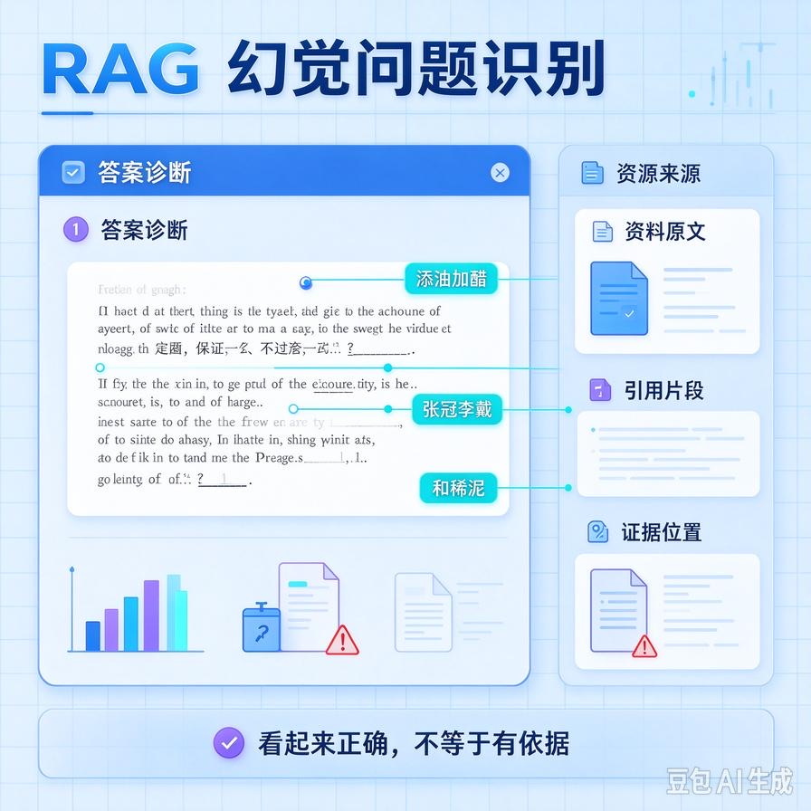
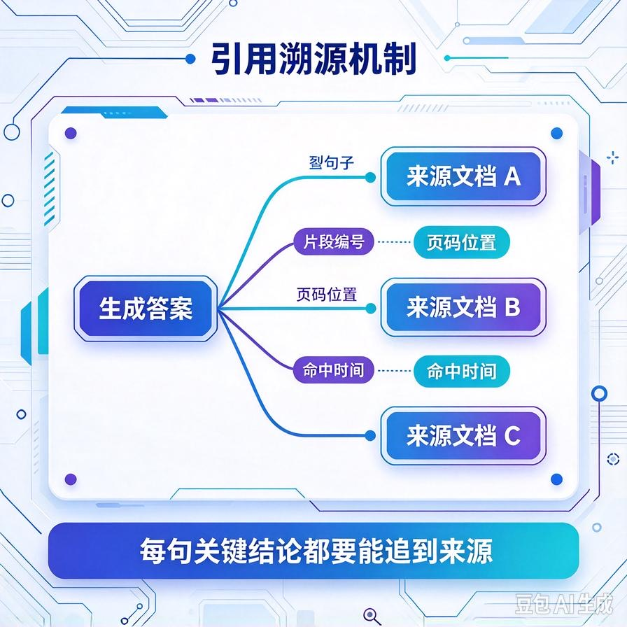
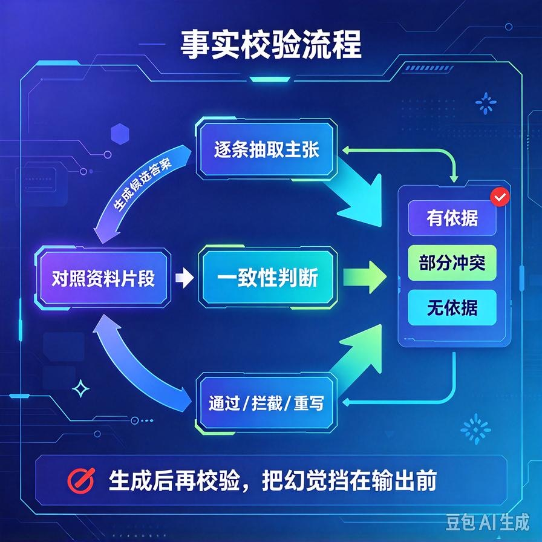
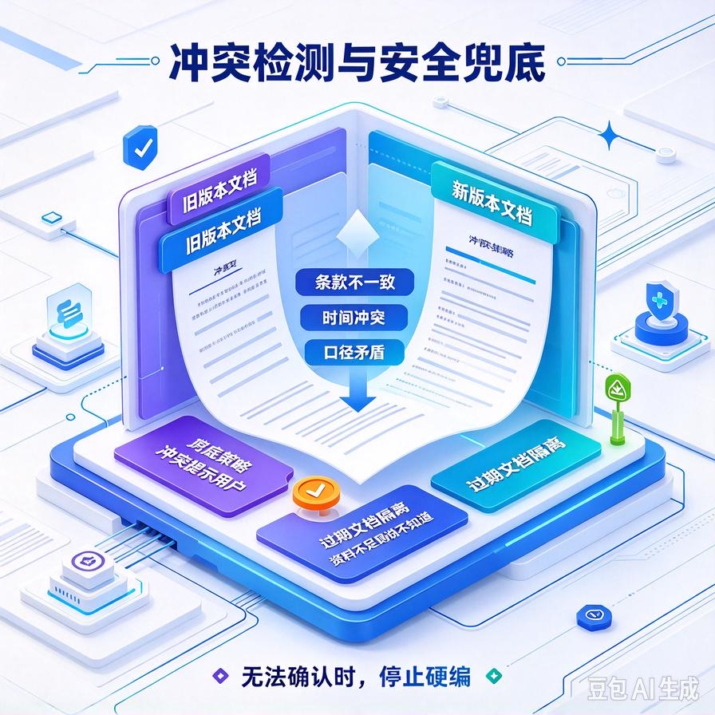

# 第74篇：RAG幻觉深度根治 | 事实校验、引用溯源、冲突文档自动检测

欢迎回到备选续更篇。

第21篇我们讲过幻觉抑制，第56篇把RAG的召回做精了。但你把一套商用RAG交付给企业，客户测试时还是会问：**"它怎么把知识库没有的数字也敢说出来？""这两份制度说法不一样，它到底听谁的？"**

这说明：召回再准，幻觉也不会自动消失。这一篇是RAG防幻觉的进阶篇，专讲三道更深的防线：**让每句话都能溯源、生成后做事实校验、知识库内部冲突自动检测**。文末附面试高频问答。


# 一、为什么RAG做精了还会幻觉



先认清一个事实：**RAG是"给模型看资料"，不是"让模型只能抄资料"**。模型生成时还是在自由发挥，资料只是背景。三种残留幻觉：

- **添油加醋**：资料里说"7天无理由退货"，模型补成"7天无理由退货，运费卖家承担"——后半句资料里根本没有；
- **张冠李戴**：把A文档的事实安到B文档头上；
- **和稀泥**：知识库两份文档说法矛盾，模型编了个折中答案。

所以防幻觉要在"生成后"再加几道独立的防线，不能只靠"把资料喂准"。

# 二、第一道防线：引用溯源——每句话都有据可查



最实用的一招：**要求模型回答时必须标注这句话来自哪段文档**，没有出处的说法一律不许写。

```python
PROMPT = """根据下面【资料】回答用户问题。硬性规则：
1. 只能使用资料里明确出现的信息，不许补充资料外的内容。
2. 每个事实后面用 [^编号] 标注来源资料的编号。
3. 如果资料里没有答案，直接说"知识库中暂无相关信息"，不要编造。

【资料】
[1] {doc1}
[2] {doc2}
[3] {doc3}

问题：{query}"""
```

引用溯源的工程价值有两层：**对用户**，客户能点进去核对，可信度大增；**对你**，如果模型标了引用但那句话其实不在对应资料里，就是幻觉信号，可以进一步拦截。

# 三、第二道防线：生成后事实校验



更硬核的做法：**生成完答案，再让模型（或规则）把答案里的每个事实和资料对一遍**，像批改作业一样。

```text
你是严格的事实核查员。下面是AI给出的回答和它依据的资料。
逐条检查回答里的每个事实陈述：
- 这个事实能不能在资料里找到明确依据？
- 有没有夸大、补充、或歪曲资料？

回答：{answer}
资料：{context}

输出JSON：{"all_supported": true/false,
          "unsupported_points": ["没有依据的说法"]}
```

发现 unsupported_points 怎么办？把这些没依据的句子删掉，或者干脆重答一次。这一步能抓出大部分"添油加醋"。代价是多一次模型调用，要权衡成本——关键客户的场景值得做。

# 四、第三道防线：冲突文档自动检测



这是企业知识库最头疼的：新旧制度并存、不同版本说法矛盾。比如旧文档说"年假5天"，新文档说"年假10天"。模型如果引用了旧的，答案就是错的。

工程上怎么处理：

- **入库时带时间/版本**：每篇文档标上生效日期，检索时优先召回最新版本；
- **冲突检测**：对召回的多条资料，让模型先判断"这些资料说法是否一致"，不一致就提示"存在不同版本规定"，而不是私自选一个；
- **过期文档隔离**：明确作废的文档打上expired标记，检索时过滤掉。

# 五、最关键的兜底：不知道就说不知道

所有防线之上，最有效的一条其实是：**资料里没有，就明确说"知识库暂无相关信息"，绝不硬答**。配合第56篇讲的重排相关度阈值——低于阈值的片段干脆不喂给模型，从源头不给它"凑答案"的机会。

商用场景里，**一个诚实说"不知道"的系统，远比一个自信胡说八道的系统值钱**。

# 六、工程踩坑清单

- **只靠召回准就指望不幻觉**：召回再准，模型仍会自由发挥，必须加生成后防线。
- **不强制引用**：客户没法核对，幻觉也难发现。
- **事实校验不看成本**：每次都加一次校验调用，成本翻倍。关键场景才上，或抽样校验。
- **新旧文档混在一起**：没带版本/时间，模型召回了过期制度。文档要带生效时间和过期标记。
- **硬凑答案**：资料不足时模型还硬编。要设相关度阈值，不足就走"不知道"兜底。

# 📝 面试高频问答

## Q1：为什么RAG做了召回优化还是会幻觉？

答：因为RAG只是"给模型看资料"，不是"让模型只能照抄"。生成时模型仍在自由发挥，会添油加醋、张冠李戴、或把矛盾资料和稀泥。所以召回准只是基础，还要在生成后加引用溯源、事实校验等独立防线。

## Q2：怎么做引用溯源？有什么用？

答：在Prompt里硬性要求每个事实标注来源资料编号，并说明资料里没有就不许编。对用户，客户能点进去核对，可信度高；对你，能据此发现"标了引用但实际不在资料里"的幻觉信号，进一步拦截。这是商用RAG提升可信度的标配。

## Q3：怎么检查生成的答案有没有编造？

答：做生成后事实校验。再用一次模型（或规则）把答案逐条和原始资料对照，找出"在资料里找不到依据"的陈述，删掉这些句子或重答。代价是多一次调用，关键客户场景值得做，普通场景可抽样校验控制成本。

## Q4：知识库里新旧制度说法矛盾怎么办？

答：三道处理。文档入库时带生效时间和版本，检索优先召回最新版、过滤过期文档；召回后让模型先判断资料间是否冲突，冲突就提示"存在不同版本规定"而不是私自选一个；作废文档打expired标记不参与召回。核心是不要让模型替你做业务上的对错判断。

## Q5：商用RAG防幻觉，最关键的一条是什么？

答：让系统在资料不足时诚实说"知识库暂无相关信息"，而不是硬凑答案。配合重排相关度阈值——低于阈值的片段不喂给模型。商用场景里，一个敢说不知道的系统，远比一个自信胡说的系统可信、也更安全。

---

下一篇是本系列备选收官：**第75篇｜移动端/端侧Agent轻量化**——小模型裁剪、本地推理、资源约束下怎么把Agent跑在手机或低配设备上。

> 来源：头条号《AI Agent 零基础实战》第74篇｜版权归作者所有，仅供学习交流
