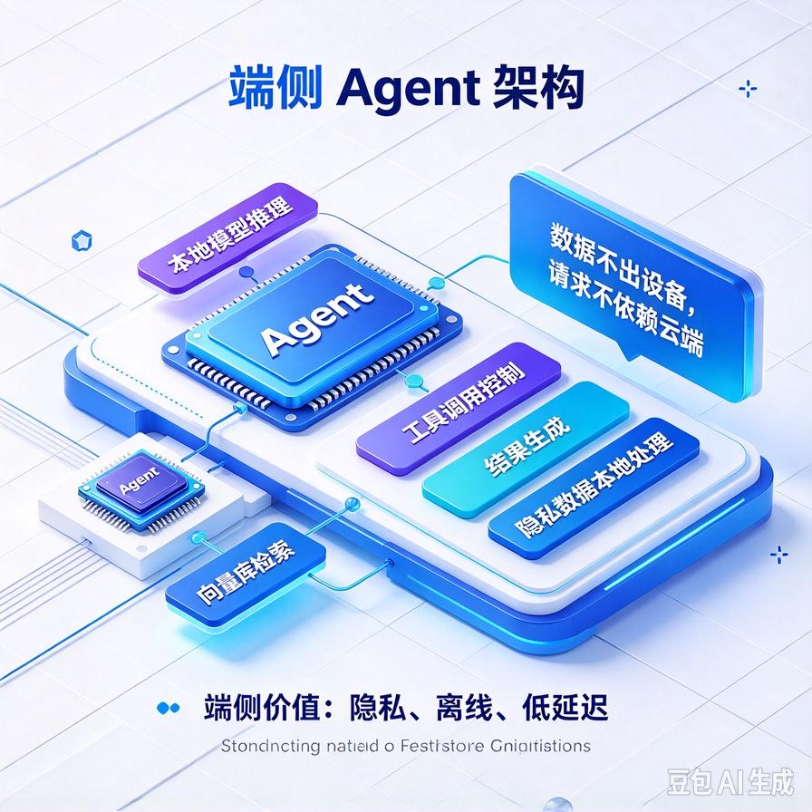
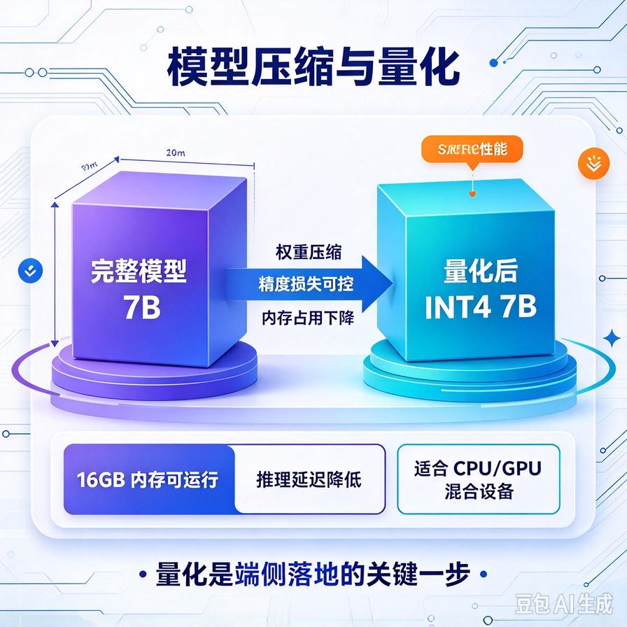
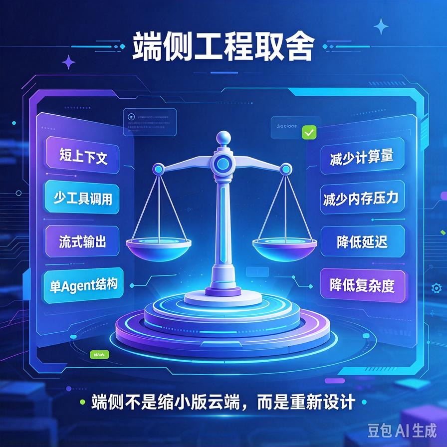
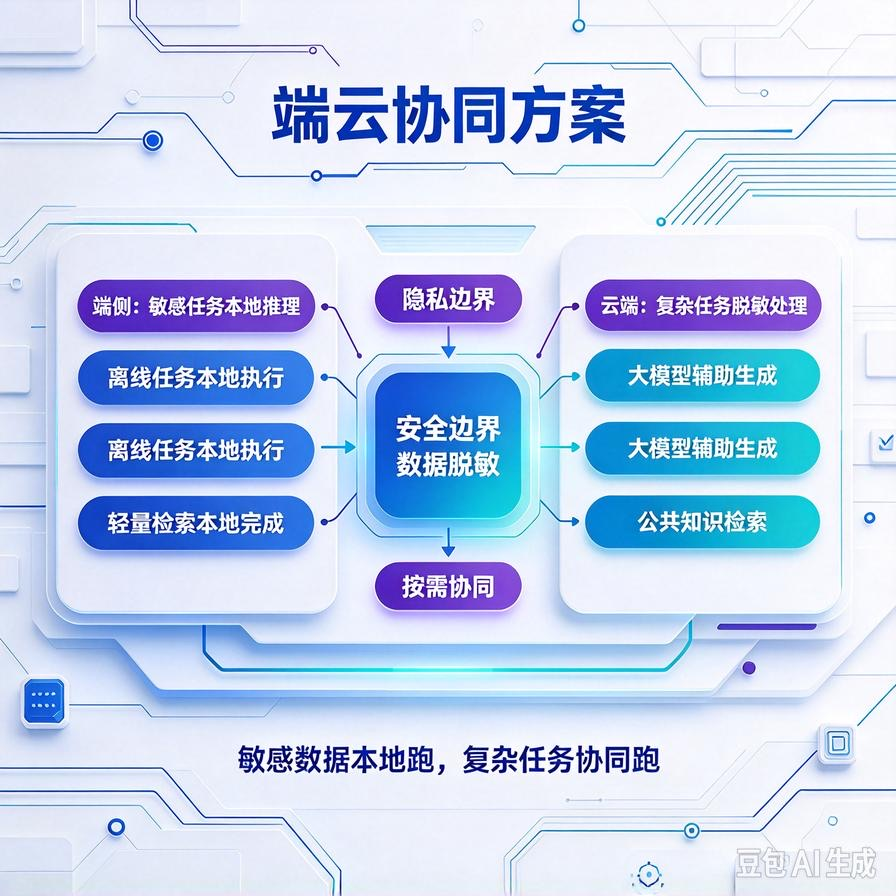

# 第75篇：端侧Agent轻量化 | 小模型选型、量化压缩、端云协同落地

欢迎来到本系列的收官篇。

前面70多篇我们都在讲"服务端跑Agent"——大模型API、向量库、服务器。但越来越多客户提这两个需求：**"我们的数据绝不能出内网/上云，能不能完全本地跑？""能不能别每个月都交API费？"**

这就引出了端侧/私有化部署：把Agent塞进一台普通电脑、甚至手机，离线也能跑。这一篇讲透它的取舍：**小模型怎么选、量化压缩怎么做、资源受限下怎么落地、以及最实用的端云协同架构**。文末面试问答后，做整个连载的收官总结。

# 一、为什么要做端侧Agent



端侧的价值很实在：

- **数据不出本地**：敏感文档、隐私数据不外传，企业最看重这点；
- **无持续API费**：一次部署，本地跑，不用按月给大厂交钱；
- **离线可用**：没网、内网隔离环境也能用。

代价也很明确：端侧算力和内存有限，跑不动几十B的大模型，效果要打折扣。所以这是一场"能力 vs 资源"的权衡。

# 二、小模型选型：够用就好

端侧不能上旗舰大模型，主流选7B（70亿参数）这个量级的开源模型。关键认知：**别追求最大，要选"在你的任务上够用"的最小模型**。

| 规模 | 能跑在哪 | 能力 |
|-|-|-|
| **1.5B\~3B** | 手机、低配电脑 | 简单问答、短任务，复杂推理吃力 |
| **7B** | 普通电脑（16G内存） | 大多数RAG问答够用，是端侧主力 |
| **13B+** | 带显卡的工作站 | 更接近云端效果，但门槛高 |

接单实战：**企业内网私有化，7B量化版基本能覆盖知识库问答；要复杂推理再考虑13B或端云协同**。

# 三、量化压缩：让大模型挤进小内存



7B模型不压缩，要占十几G内存，普通电脑跑不动。**量化**就是把模型参数从高精度（16位）压成低精度（4位/8位），体积和内存占用大幅下降，效果损失很小。

- **INT8量化**：体积减半，效果几乎无损；
- **INT4量化**：体积压到1/4，效果略降，但能在16G内存的电脑流畅跑——端侧最常用。

```bash
# 一行命令拉取并运行一个7B量化模型
ollama run qwen2.5:7b

# 它会自动起一个本地接口，你的Agent直接调用
# http://localhost:11434/v1/chat/completions
```

对接单的同学，**ollama这类工具已经把量化、本地推理封装好了**，你不用自己折腾底层，重点是会选模型、会调参。

# 四、资源约束下的工程取舍



端侧跑Agent，处处是限制，要主动做减法：

- **上下文别太长**：端侧内存吃紧，检索喂的文档要少而精（呼应第19篇Token压缩）；
- **工具别太多**：工具一多，小模型Function Calling容易出错，端侧只留最必要的几个；
- **响应要快**：本地推理慢，别让用户等太久，必要时流式输出（第62篇）改善体验；
- **别硬上复杂多步Agent**：多Agent协作（第59篇）这种重架构，端侧小模型扛不住。

# 五、最实用的架构：端云协同



纯端侧效果有限，纯云端又过不了隐私关。实战中最香的是**端云协同**：

- **简单、敏感的任务在端侧跑**：本地小模型处理日常问答、敏感数据不出本机；
- **复杂、非敏感的任务上云**：真需要强推理时，脱敏后调用云端大模型；
- **按任务路由**：这正是第69篇模型路由思路的延伸——只是"路由"从"选哪个云端模型"变成了"本地还是上云"。

这套架构既守住了数据隐私，又保住了复杂任务的效果，是企业私有化交付的主流方案。

# 六、工程踩坑清单

- **盲目上最大模型**：端侧资源有限，跑不动还卡。选够用的最小模型。
- **不做量化**：7B模型十几G内存，普通电脑直接OOM。必须量化。
- **把云端那套复杂架构照搬端侧**：多Agent、长上下文、一堆工具，小模型扛不住。端侧要做减法。
- **忽视推理延迟**：本地推理慢，不做流式输出体验很差。
- **非黑即白**：要么纯本地要么纯云。多数场景端云协同才是最优解。

# 📝 面试高频问答

## Q1：端侧部署Agent有什么价值和代价？

答：价值是数据不出本地（隐私合规）、无持续API费、离线可用。代价是端侧算力内存有限，跑不动大模型，效果打折扣。本质是能力和资源的权衡，所以要选够用的小模型、做量化压缩，并配合端云协同。

## Q2：什么是量化？为什么端侧必须做？

答：量化是把模型参数从高精度（16位）压成低精度（INT8/INT4），体积和内存占用大幅下降，效果损失很小。7B模型不量化要占十几G内存，普通电脑跑不动；INT4量化后能在16G内存的机器流畅跑。端侧内存受限，量化几乎是必做步骤。

## Q3：端侧跑Agent要做哪些工程取舍？

答：处处做减法。上下文要短、检索喂的文档少而精；工具只留最必要的，小模型工具调用多了容易出错；响应慢就用流式输出改善体验；别硬上多Agent这种重架构。端侧的核心是"够用、流畅、稳定"，不是堆功能。

## Q4：纯端侧效果不够，纯云端又过不了隐私关，怎么办？

答：端云协同。简单和敏感的任务在本地小模型跑，数据不出本机；复杂、非敏感的任务脱敏后上云调用大模型。本质是把模型路由的思路从"选哪个云端模型"扩展成"本地还是上云"。既守隐私又保效果，是企业私有化交付的主流方案。

## Q5：给一个完全离线的企业内网做Agent，你怎么落地？

答：选7B量级开源模型，用INT4量化后部署在内网一台普通服务器上（或用ollama这类工具快速起本地接口）；RAG的向量库也在内网本地跑；工程上做减法——短上下文、少工具、流式输出。敏感数据全程不出内网，也没有持续API费用。这就是一套完整的私有化离线方案。

---

# 写在最后：这套连载你到底拿到了什么

从第1篇"读懂Agent核心逻辑"走到这里，我们一起走完了一条完整的路：

- **技术筑基（1\~28）**：从原理到RAG、记忆、工具调用，把Agent是怎么回事彻底搞懂；
- **接单变现（29\~40）**：从零案例到首单破零、获客成交，把技术换成钱；
- **商用改造（41\~45）**：Demo变产品、接口封装、成本控制；
- **高阶技术专题（52\~75）**：从架构、ReAct、Function Calling，到状态机、安全、多租户、可观测、灰度、幻觉根治、端侧——全是商用级难点和面试硬核。

你现在手里这套东西，既能支撑你去接企业单子、做自己的产品，也能让你在AI应用岗的面试里，从"会调API"升级到"懂工程、能扛生产"。技术会一直更新，但**这套"从场景出发、用代码落地、踩坑复盘、对接面试"的思维方式，是长期受用的底牌**。

全系列到这里正式收官。接下来，去把它变成你自己的案例和收入吧。

> 来源：头条号《AI Agent 零基础实战》第75篇｜版权归作者所有，仅供学习交流
